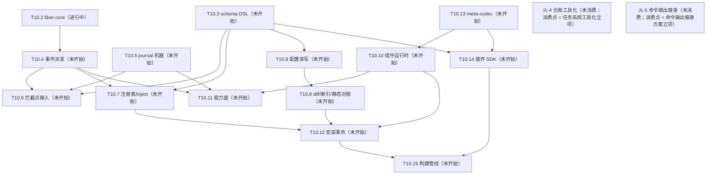

# Metis 台账（backlog）

> 状态：🔵 活跃（living；2026-10-14 立 = [ADR-0032](decisions/0032-operating-protocol.md)）。本文件 = 任务队列 + 遗留登记 + 火花区 + 全景图四位一体的**运行状态 SSOT**（git 追踪）。**临时方案**——长期需要一个工具承担任务状态管理，而非并发 agent 直接读写本文件（火-4；扩展位登记 = [operating-protocol](design/operating-protocol.md) §6）。

## 读写纪律

- agent 全权维护：任务块状态、进展、收官压行由 agent 在会话收尾更新，随当次 commit 入库，无需逐项请示。
- 维护者聊天驱动：任务开立、拍板、方向变更由维护者对话触发；agent 不自立任务。
- 任务粒度闸：任务在设计 / 开立时即过 [operating-protocol](design/operating-protocol.md) §2 任务粒度（切分三属性 + 验收单元容量预算），非待拆分才过；超阈值的处置 = 拆分，方案以议题批出示、合并拍板。
- 任务块状态行 = 状态词（AGENTS.md Reporting 十词）+ 已完成范围 + 下一步 + 未拍板项 + 评审面三数（拍板决策点数 / self-review findings 数 / 评审耗时量级——诊断位，不设门禁）。
- 任务生命周期状态 = 未开始 / 进行中 / 阻塞 / 已完成 + **延后（deferred）**：无限期延后，重开 = 维护者明示——延后是队列处置态，不进 Reporting 十词。
- 收官压单行与离库：任务收官后块压成单行（状态词 + 日期 + 产出指针 ADR+SHA），过程叙事溯源 = ADR 正文 + git 史；收官行 = 衔接过渡态，默认存活约一个任务周期——旧行清理走压缩仪式微缩版（下次收官或巡检时出示 → 维护者批准；[doc-lifecycle](design/doc-lifecycle.md) §7），deferred 行例外（队列处置态，留至重开或维护者明示丢弃）。
- 并发窗口一任务一写者：同一时刻一个任务块只有一个写者；并行窗口内每 agent 只写自己的任务块（[operating-protocol](design/operating-protocol.md) §3）——写冲突结构性规避，不靠锁。
- **注册先于执行（2026-10-15 维护者立，为以后所有任务/工作的前提）**：任何跨 session 的工作单元必须先在本台账登记为可续单元（任务块 / 下一步行 / 剩余工作清单），再执行；session 可随意中断，新 session 仅凭本台账续作——工作状态不以会话内记忆为载体。
- 文档结构性改动视同共享契约串行：本文件的节结构与任务块格式改动不走并行窗口。
- git 追踪原则（维护者原话）：「我们不能依赖任何非 git 追踪的文件。不然会非常容易出现悬垂指针，导致文档腐烂。」——运行状态一律 git 追踪；外部服务只作对外接口（GitHub Issues 不迁队列、不建 label；外部事项被采纳时才以链接条目进本台账，单写者、无双向同步）。

## 全景图（活跃任务 + 未消费火花；任务或火花变更时重生成）

图 = 派生视图（内容 SSOT = 任务块与火花登记区）：只画活跃面（未开始 / 进行中 / 阻塞）+ 未消费火花节点（label = 火-N + 短语 + 消费点）；已完成 / 延后节点离图，已满足依赖不画边（满足态住任务块「依赖」行）；边 = 传递归约后的硬依赖（无路径相连 = 结构可并行面）。

## 内部任务

活跃任务一任务一块（状态词 / 依赖 / 进展状态行含评审面三数 / 产出指针）；收官或延后任务压单行（见末节记录）。

### T10 实现

- 状态：**进行中**（T10.0b ✅ 2026-10-16（验收 = 维护者明示收尾，抽检配额未执行在案）；已完成 = Q1–Q11 拍板固化 + 0a 六件（gate-guard 机器闸 / machete 进 lint / llvm-cov 工具链 / cov-floor 空地板闸 / testing-ledger + test-telemetry / insta 语料孤儿闸）+ Q10/Q11 + station-run 增补「收官不自动开下一站」+ 0b 一件（`just deep` 慢轨 recipe = llvm-cov 工作区报告 + 膨胀遥测腿，本地按需；远程周跑 workflow 与自动开 issue 机制仍归 T10.2）+ T10.1（metis-value crate + mutants 工具链固化 + cov-floor 首钉 98.8 + 首份 D11 声明 + exemplar 教学回写 station-run，2026-10-20 验收）；下一步 = T10.2 开工批拍板（2026-10-20 维护者开启本站，批已出示：依赖准入 4 件（slotmap / indexmap / proptest / kani 工具链）+ 实现期配置三值 + SIGTERM 定案 + 周跑 workflow 形态）→ 拍板后进入实现循环；未拍板项 = T10.2 开工批 4 组）
- 依赖：T11（✅ 2026-10-14）/ T12（✅ 2026-10-14 = [ADR-0033](decisions/0033-doc-lifecycle.md)）——开工门槛全备
- 站表（依赖列 = 硬依赖，即不可提前的并行面边界；清单锚点指向各 doc 登记原位不转抄；除 T10.0a/b 外每站自带 F 类写实清单（D8）；内核 crate 站自带 D11 测试来源声明 + llvm-cov 地板线（首钉 = T10.1））：
  - T10.0a 质量基建·快轨与机器闸 ✅（2026-10-16 验收；维护者明示收尾、抽检配额未执行在案；SHAs = c40ad79…0c632a4）——门禁面（justfile / `.pre-commit-config.yaml` / rust-toolchain.toml / crates/xtask）；依赖：无（非硬阻塞，后续站消费其门禁件故推荐最先）；清单 = [ADR-0031](decisions/0031-testing-strategy.md) Consequences 实现期清单（指针不转抄）；拍板形态（2026-10-15，Q2–Q5/Q7/Q8）= xtask `gate-guard`（commit trailer 机器闸；§4.2 清单 xtask 硬编码 + 注释指回散文 SSOT）+ AGENTS.md NEVER 增补 / cargo-machete 进 `just lint` / cargo-llvm-cov + rust-toolchain `llvm-tools-preview` 组件 / xtask `cov-floor` + `.config` 空地板文件（登记进 §4.2 修订注）/ `docs/testing-ledger.md` + xtask `test-telemetry`（增长率历史不做）/ `insta --unreferenced=auto` 进 `just ci`；追加（2026-10-15 Q10 拍板）= deny.toml duplicate skip 静音基线 + `-D unmatched-skip` fuse（随批落地，非 ADR-0031 原清单项）；HARD 人审门，依赖件逐项走 adding-dependencies。
  - T10.0b 质量基建·慢轨件 ✅（2026-10-16 验收；维护者明示收尾、抽检配额未执行在案；SHAs = b9c0e69…8880e7d）——`just deep` recipe（本地）；依赖：T10.0a（✅ 2026-10-16）；拍板形态（2026-10-15，Q1/Q6）= 首批内容 = llvm-cov 报告 + 膨胀遥测件（非空 recipe；§2.4/§5 原触发器提前，修订注在案）；远程周跑 workflow 与慢轨失败自动开 issue 机制推迟至 T10.2 随 mutants 首个硬门禁件落地。
  - T10.1 metis-value ✅（2026-10-20 验收 = 维护者拍板议题 A 收官，抽检配额未执行在案；SHAs = c02001b…676c332；远程 CI = run 39386531806 ✅ 至 612035f，收官两笔随本批推送核验）——`crates/metis-value`；依赖：无；锚 = ADR-0015/0022 + [wit-abi](design/wit-abi.md) W6 D155–D158（Value 相关子集；考古源 = luau-abi §A6.3/§A6.8 登记表）；Bytes 已提正 = [ADR-0042](decisions/0042-value-bytes.md)（W6 D158）。产出 = `Value` 八变体 + `BTreeMap` + 编译期 Send+Sync 断言（零依赖）+ 首份 D11 声明（mutants 27.1.0：44 变异体 / 31 擒获 / 13 unviable / 0 missed）+ cov-floor 首钉 98.8；F 类 = 空清单（纯数据 crate 无崩溃窗口）；exemplar 教学已回写 station-run。 + [wit-abi](design/wit-abi.md) W6 D155–D158（Value 相关子集；考古源 = luau-abi §A6.3/§A6.8 登记表）；Bytes 已提正 = [ADR-0042](decisions/0042-value-bytes.md)（W6 D158）。
  - T10.2 metis-fiber-core——`crates/metis-fiber-core`（禁 tokio/mlua）；**进行中**（2026-10-20 开工；pre-flight 完成 = 依赖闭环（T10.1 ✅）/ 锚清单抽取 / 粒度复检一站可收 / D11 计划定 / 门禁面与收官基建核对完；开工批 4 组待拍）；依赖：T10.1；锚 = ADR-0010/0019/0023 + fiber.md §10 开放项（SIGTERM 处理 / drain 总预算数值）+ [wit-abi](design/wit-abi.md) W4 D93–D97（exclusive 名字回收 D1.2 归 T10.14 / [plugin-sdk](design/plugin-sdk.md) S4；wait-for 图 D1.7 运行时 = W4.4 D96，可见性上报 = plugin-sdk S4 扩展位；考古源 = luau-abi §A4.6）与实现期配置行（在飞协程预算与事件在途投递界 D10.2 / 优雅窗口 + drain 预算 D11.1）；随站 = Kani（D7）+ mutants 门禁（D4）+ D6 fiber 内存件；另随本站落地 = 远程周跑 workflow 首建（碰 `.github/workflows/`，ADR-0031 已授权）+ 慢轨失败自动开 issue 机制（2026-10-15 Q1/Q6 拍板划入）。
  - T10.3 schema DSL——`crates/metis-loader`；依赖：T10.1；锚 = [wit-abi](design/wit-abi.md) W7 D163–D172 + W8 D175（事件形状总表合并）+ W9 D180–D185（反向索引（契约引用）= W9.13）+ config-format.md（schema `type:` 接线）（考古源 = luau-abi §A7.0–§A7.5 / §A8.5）——A7 半消融 = E5 拍板：记法裁至只服务 Value 形状（`buffer`/`function` 等 ctx 面词族消亡），config schema `type:` 接线与契约包三来源存活；新增 = 契约包加载与契约命名空间合并（YAML 契约包；W7 D164–D168）+ 平台固定 world 的 WIT 包加载（wit-parser 系选型走 adding-dependencies；三分法①）；形态定稿锚 = wit-abi W2/W7 章。
  - T10.4 事件系统派发——`crates/metis-runtime`；依赖：T10.2；锚 = ADR-0011/0013/0014/0016/0017 + context-events.md §0.3 修订注（背压面写实 + worker 伪码语义更新两件实现期登记）+ [wit-abi](design/wit-abi.md) W4 D93–D97（考古源 = luau-abi §A4.2（tokio 可学结构）；§A4.6 裸 yield 检测 D9.3 已消亡 = design-review A7）+ W8 D173–D179（emit 校验 D176 / `on-event` D177）；随站 = D6 事件吞吐件。
  - T10.5 journal 机器——`crates/metis-runtime`；依赖：T10.1；锚 = journal.md J1.2/J1.3/J1.4/J1.6/J3.6/J4.2/J4.4 实现期清单行（存活 10 项；JSONL + Int 字符串惯例 = J1.2/J1.3 + J4.2 D90）+ [wit-abi](design/wit-abi.md) W6 D156/D158/D162（Bytes JSONL = base64；深快照预算 = D156/D162；考古源 = luau-abi §A6.7 D7.3 / §A6.2；D7.3 Int 半 = journal.md J1.3）；D5 快照纪律随站。
  - T10.6 拦截点接入——`crates/metis-runtime`；依赖：T10.3 / T10.4 / T10.5；锚 = journal.md D82/D84（拦截点骨架形态；范围 = router / 生命周期机两族）+ [wit-abi](design/wit-abi.md) W8 D173–D179（本站只接拦截点骨架；emit 校验 D176 实现归 T10.4，`internal/*` 冒用拦截 D178 归 T10.10/T10.11；考古源 = luau-abi §A8.5）；**能力使用族与 VM 族拦截（挂载位 = ctx 方法）划出本站 = T10.11**。
  - T10.7 服务注册表/inject——`crates/metis-runtime`；依赖：T10.2 / T10.3 / T10.4；锚 = service-registry.md S1–S6 机制本体（扩展位 5 处不做：withdraw / host 有界等待 / 跨 VM 取消 / check 谓词 / 自动重试）+ instance-model.md S3.7/S4.8 登记（D61/D63/D64/D68/D70/D72）+ [wit-abi](design/wit-abi.md) W9 D180–D185（对账五格 / warn 日志点 / required 依赖图；考古源 = luau-abi §A9.2）+ W1.5/W1.6（加载与 dispose 预算语义；数值归 T10.10/T10.14，考古源 = luau-abi §A1.4）+ config-format.md D43 级联执行半（与 T10.9 检测半汇合）；开工核对 = service-registry §3/§7 两格兑现抽查；**最大站——开工先过粒度闸，超阈值处置 = 拆 7a registry 本体 / 7b 实例与 mount 面**。
  - T10.8 配置读写管线——`crates/metis-loader` + runtime 胶水；依赖：T10.3；锚 = config-format.md C1–C3/C5/C6/C8 各章联动登记（D29 脚手架两件 / D36 读管线 / D39 原子写与串行队列 / D40 行块补丁器 / D47 secrets 内存 map 与两分 / C6.4 D135 共享变量解析 / C8 core 节容器校验）+ instance-model.md D67（实例配置合成器）。
  - T10.9 diff/reload + 部署索引——`crates/metis-loader`；依赖：T10.8；锚 = config-format.md C4/C7/C9 联动登记（D41 diff 器 / D42 重入与结构相等 / D43 检测半 / D34 部署索引扫描含残迹 / D52 analyze 判环 / 显式 reload 命令形态）+ [wit-abi](design/wit-abi.md) W7.12（部署 / 级联反向索引）+ W9 D180–D185（考古源 = luau-abi §A8.5 部署契约索引 / §A9.1 部署索引）+ instance-model.md S2.6（fleet 校验 D56/D60）——静态/纯算法面全存活；消亡 = 钉版 luau-lsp / AST 选型 / 四生成器（design-review A8）；换血 = `abi` 字段（WIT package version）接受判定（[wit-abi](design/wit-abi.md) W10 D187：精确声明 ∈ 支持快照集 + 三合一（声明 / 结构 / 词汇表）；A10 D27.2 min 语义不复活；W2 D132）+ 组件自描述进口清单解析进部署索引（D24.1 面扩展；进口词汇表结构对账 = B1 编译期结构事实，安装期记录、启用时响亮 = W9 D180–D182，判定面归 T10.7）+ emit 对账形状源 = 瘦身形状 DSL（E5）；**收窄 = 静态/纯算法面，生效动作执行（重挂载 / 级联重启用 / 卸载生效）划出 = T10.7 启用管线与 T10.12 汇合**；开工输入 += [wit-abi](design/wit-abi.md) W10 D187（ABI 接受判定；比较函数与部署索引记录结构版本）。
  - T10.10 组件运行时——`crates/metis-component`（wasmtime 嵌入：Store/Instance 管理、实例即弃池化、fuel/epoch 预算、host imports 注册、wasm trap 处置接 fiber 错误遏制）；依赖：T10.1 / T10.13；锚 = ADR-0005（遏制四约束原生兑现 = design-review D2）+ wasm-research 补遗 5 §5.4（边界拷贝语义四层）/ 补遗 6（S1 矩阵 + papercuts）/ 补遗 10（S3 blob 跨实例句柄）/ wit-abi W1/W4/W5/W6 章（设计锚）；W6 增补 = 每实例 `ResourceTable`、blob 注册表（`Arc` + 引用计数）、跨 Store 句柄重物化、resource 析构与预算；`.cwasm` 缓存；wasmtime 引入走 adding-dependencies（ADR-0034 风险 W4）；原 Luau 锚点（push_int64_exact / coroutine shim spike / mlua 处置件）全失效，空壳 `crates/metis-luau` 已于 T13-b 批删除；开工输入 += [wit-abi](design/wit-abi.md) W10 D189（逐快照绑定 / 路由 / `vocabulary.yml` / 无协议翻译层）；W8 D178（`internal/*` 冒用拦截）；开工首件 = `crates/metis-plugin/wit/<version>/` 目录落盘（W1.2 位置；SDK 实现归 T10.14）；开工前重检 trap→fiber 是否升为硬依赖（T10.2）。
  - T10.11 能力面——`crates/metis-runtime` 能力实现 + metis-component host imports 暴露（ctx 面 = WIT imports，作者面 SDK 映射归 T10.14）；依赖：T10.4 / T10.5 / T10.10；锚 = seam-capabilities.md（ADR-0025 能力集语义本体存活：fs/http/timer/process；sqlite 撤回 = ADR-0039（DB = guest crate + private fs，无宿主句柄）；§1 stdlib 卫生章消亡 = design-review A1，清写归 T13-f）+ E4 修订两档（private = WASI 0.3 wasi:filesystem async（preopen，隐式读写）/ global = host-mediated 自研逃逸舱，manifest `fs: read|write` 声明；命名根撤回 = ADR-0039；workspace/session 语义归插件层服务投影，核心不做一一映射）+ [wit-abi](design/wit-abi.md) W3 D142–D154（能力预算数值 / TOCTOU 硬化 = [seam-capabilities](design/seam-capabilities.md) §5.2 两段式解析；考古源 = luau-abi §A3.6–§A3.10）+ design-review B2（纯算内建件族消解进 guest 包生态，核心收缩 = 效应能力 + wasi 标准件；crypto 撤回 = ADR-0041，guest crate + wasi:random；seam §2.1 微基准与 sync 白名单机器大半随之消亡）+ journal 能力使用族 / VM 族拦截（自 T10.6 划入，挂载位 = host import 实现侧）+ wit-abi W5（错误族 D137 与未声明能力 trap D139）+ W6 D159（`open-read` / `open-write` / `download` / blob 创建 / collect）+ W8 D173（事件名长度预算）/ D178（`internal/*` 冒用拦截）；消亡 = §A6.4 D4.3 UTF-8 校验与 buffer 面（WIT `string`/`list<u8>` 原生）。
  - T10.12 安装事务——`crates/metis-loader` + runtime 协调；依赖：T10.7 / T10.8 / T10.9 / T10.10；锚 = ADR-0008（审批门 v1 接口预留不实现）+ [build-pipeline](design/build-pipeline.md) D109（安装事务 / 失败回滚与旧版本恢复；考古源 = luau-abi §A4.5：事务式重载联动行；D11.5 处理结果保证分级 live = W4.5 D97）+ config-format.md C4（config reload）+ C7（D48/D49 卸载两档）+ W8 D177（安装期 `on-event` 导出检查）+ testing-strategy.md §3.F（F 类基建落地，failpoint 选型走 adding-dependencies）+ D6 热更件。
  - T10.13 metis-codec——`crates/metis-codec`（TLV 线编码 crate，双 target = 宿主与 guest 共用）；依赖：T10.1；锚 = [wit-abi](design/wit-abi.md) W5（business data = TLV Value）+ W6 D155/D156/D158（canonical 编码 / `ValueRef` / `encoded_len` + `encode_into` / bytes tag；blob 不进 TLV；考古源 = luau-abi §A6.6：box 载体已消亡，TLV value 格式 + 版本字段 = W6 D156）——E1 选项① 拍板主线化（自范围外拨出，位分配冻结时点 = 首插件发布前原位）；D11 声明 + cov 地板 + round-trip 测试基线随站；W10 D190 冻结其格式版本与位布局。
  - T10.14 插件 SDK——`crates/metis-plugin`（guest 侧官方 SDK，ADR-0034 §4：`#[metis::plugin]` 宏藏 ABI + trait 实现形态，作者不见 WASI/WIT；world 固定，能力白名单 = manifest 声明对账）；依赖：T10.1 / T10.3 / T10.13；锚 = 先例（proxy-wasm SDK / zed_extension_api / Spin / Extism PDK 宏藏 ABI 模式）+ 三分法②（瘦身形状 DSL → 具体 Rust 类型生成，`any` 回落 `metis::Value`）+ E3 拍板（宿主零同步原语：fanout = guest 异步设施原生、exclusive = SDK async mutex 助手；D1.2 三规则重估面随站）+ design-review B2（内建件便利 re-export = feature 面）+ WASI 0.3 基线导入 / world 收敛（补遗 9；wasip2 14 导入为历史）；开工输入 += [plugin-sdk](design/plugin-sdk.md)（T13-d 定案 S1–S7 = D98–D104）+ wit-abi W1/W3/W5/W6 章（W6 增补 = `Payload` / `Blob` / `ByteReader` / `ByteWriter` / `Value::Bytes` + typed decode）；D11 声明随站（guest 面形态随站定）；W10 D189/D190 开工输入 = 只对当前快照生成、脚手架写 WIT hash、首个冻结快照执行与 hash 校验、`abi` 作者指南（首个外部分发前）。
  - T10.15 即写即用构建管线——`metis dev` watch 守护（保存 → 构建 → 热换 = 主答案）+ 构建缓存 + 脚手架模板；依赖：T10.12 / T10.14；锚 = ADR-0034 §6 四件（watch / 构建缓存 / 部署内工具链服务（可选件 = Creator 体面退场形态）/ 远端构建场（marketplace 配套，与确定性构建信任链同管线）——后两件触发器未满足，不进 v1 面）+ design-review B9（地板实测：增量重建 0.22–0.29 s + 实例化 1.7 µs）+ ADR-0034 风险 W3（WIT 包 SSOT + wit-bindgen/wasm-tools/wasmtime 钉版纪律）+ `metis sdk` 命令面重组（D28.1 存活件 = new/check 归本面与 T10.9 同实现；analyze 读代码扫描面消亡 = design-review B1；W10 D193 已兑现：ABI 判定单一实现两层执行）；开工输入 += [build-pipeline](design/build-pipeline.md)（D105–D115）+ [build-pipeline-survey](research/build-pipeline-survey.md)；W6 增补 = world import 集含 `blobs` / `streams` / `payloads`；F 类窗口 = build-pipeline §15（收官时迁入 testing-strategy §3.F）；D11 / cov-floor 若新增内核 crate 则按 station-run 义务；W10 D193 = ABI 判定落点（声明层 / 结构层）、预检共用实现；平台 / 生态契约副本获取路径（`metis sdk export` = 扩展位）+ `types!()` 引用契约的包内存在性校验。
- 范围外（触发器未满足）：registry 扩展位 5 处 / context-events §0.5 优化位 / `metis install` 工具化与分发机制（长回）。（2026-10-16 T13-b 拨出三件：metis-codec TLV 位分配 = E1 选项① 主线化提正归 T10.13；盒 trap 句柄处置随盒概念消解（ADR-0034 §2）归 T10.10 本体；WIT 生成器（盒面）随 Luau 工具面全撤消亡 = design-review A8。）
- 开窗前置：worktree bootstrap 自动化（[ADR-0032](decisions/0032-operating-protocol.md) Consequences 登记，届时再建）。
- 评审面三数：拍板 21（2026-10-15 拆分批 Q1–Q6 + T10.0 批 Q1–Q9 + Q10/Q11 + 验收包四项：bddb55b 保留不重置 / flake.nix 不入 §4.2 / 推送归并行会话 / 暂存规则不立——并行同工作区为特殊态）/ self-review findings 23（站表 pass 7 已随块修复；0a 批 8 笔 commit 判断 pass 共产出 14 Required 随笔修复；llvm-cov / insta 两笔判断 pass 漏跑、事后追认 pass = clean，流程漏记一条在案；0b 批 2 Required（backlog 随行 + Gate-Surface trailer，均落地形态项随笔处置）+ 1 Nit / 1 Optional 推回在案）/ 耗时 <1h ×2（0a/0b 均验收会话即收尾，抽检配额未执行）；T10.1 ✅（2026-10-20）= 拍板 1（mutants 入 flake 固化长期工具位）/ findings 7（flake pass 2 Required + 1 Optional；crate pass 1 Required + 1 Nit + 2 Optional，落地或明示延期在案）/ 耗时 <1h ×2（两笔 commit 各一次判断 pass）
- **2026-10-15 方向变更注**：wasm-first 转向拍板（= T13，维护者对话）——T10.3 / T10.9 / T10.10 / T10.11 已随 T13-b 修订（2026-10-16，另新增 T10.13/14/15 三站）；T10.0a/b 与 T10.1/2/4/5/6/7/8/12 的语言无关面继续有效。其余站线散见 Luau 子锚点开工核对四项：T10.2 的 exclusive 名字回收 D1.2 随 E3 拍板归 T10.14 SDK 助手面；T10.4 的裸 yield 检测 D9.3 消亡（guest async 运行时自管，design-review A7）；T10.8 的 D29 `.luaurc` 脚手架件消亡（require 体系全链 = A2）；T10.7 的盒对账格 D25.5 升格为全插件进口对账（B1，语义原位存活）。

### 收官与延后记录（单行）

- T9 marketplace 格式设计 — **deferred**（2026-10-14 维护者裁定：无限期延后；重开条件 = 维护者明示）。
- T13 wasm-first 转向 — **已完成**（2026-10-19；产出 = [ADR-0034](decisions/0034-wasm-first-carrier.md)（0021/0026 整篇 supersede、0024 局部、luau-abi 归档）+ ADR-0035–0044 + [wit-abi](design/wit-abi.md) W1–W10；D98–D115 见 [plugin-sdk](design/plugin-sdk.md) / [build-pipeline](design/build-pipeline.md)；分析 = [wasm-first-design-review](research/wasm-first-design-review.md)；过程 = git 史（T13-a…p）；S1/S2/S3 spike PASS = [wasm-research](research/wasm-research.md) 补遗 6/7/10；SHAs = `f5bdc7c`…`7046fd3`（逐批见 git 史）；远程 CI = run 39281899910 未验证（事故 queued，恢复后 rerun 可确认）；验收 = 维护者 diff 评审）。

## 外部事项

（空）GitHub Issues = 对外接口本位：不建 label、不把队列迁 issue；外部事项被采纳时才以「链接条目」进本台账（单写者、无双向同步）——ADR-0032。

## 遗留问题登记

- **默认插件集**（开箱即用参考实现）——原则已定（ADR-0024 §4）；shell tool / schedule 插件候选在案；核心设计链已收官，可立项。
- **global 核心数据根可达性复审**（self-review 提出）：若收紧，同批改 config-format.md §C5.1（global 可达部署根）+ seam-capabilities.md §5.2 / wit-abi W3.3（global fs 两档）。
- **秘密引用限审批档收紧裁量**（D67 明记代价；维护者裁量未做）。
- **org 级「允许 Actions 开 PR」开关**：org Settings → Actions → General → Workflow permissions 勾开（repo 级随后同开），或 `gh auth refresh -h github.com -s admin:org` 后走 API；未开前 flake-update / toolchain-update 周更在开 PR 一步 403，其余 CI 不受影响。

各类**扩展位/复审触发器**均已在对应 ADR/设计文档内登记（SSOT 原位不动，不迁）。

## 火花登记区

机制 = AGENTS.md Style 节 spark-capture 规则：引文逐字登记不压缩；消费 = 内容升格固化进对应 docs/ 或代码，条目即从本区删除（去向处即 SSOT 不留痕，本台账 git 史保底）；未消费不静默消失；议题出示前回读本区。

- 火-4（2026-10-14；消费点 = 任务系统工具化立项，未消费）：「先做临时方案吧，后面我们应该需要一个工具去做这个事情，而不是让并发的agent去读写这个内容。」；上下文锚 = 任务 11 改稿拍板回复（本台账定调）
- 火-5（2026-10-15；消费点 = 命令输出瘦身方案立项（质量基建扩展或独立任务），未消费）：「我们一些高频调用的命令，如 just 系列，just ci 之类的，我们在成功时并不关心其详细的输出，只在错误时才希望有详细的输出。并且冗余的输出也会污染agent的上下文。这里后续希望能探索一个有效的方案，用来简化这些输出。」；上下文锚 = T10.0 开工会话（Q1–Q9 拍板同回复附带；候选方向 = 成功静默/失败详输的包装、日志落盘 + 尾行摘要、工具静默旗标盘点）
