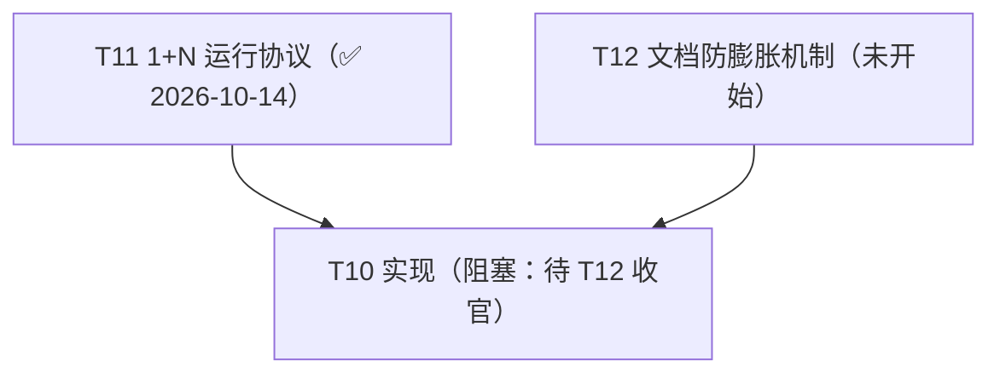

# Metis 台账（backlog）

> 状态：🔵 活跃（living；2026-10-14 立 = [ADR-0032](decisions/0032-operating-protocol.md)）。本文件 = 任务队列 + 遗留登记 + 火花区 + 依赖图四位一体的**运行状态 SSOT**（git 追踪）。**临时方案**——长期需要一个工具承担任务状态管理，而非并发 agent 直接读写本文件（火-4；扩展位登记 = [operating-protocol](design/operating-protocol.md) §6）。

## 读写纪律

- agent 全权维护：任务块状态、进展、收官压行由 agent 在会话收尾更新，随当次 commit 入库，无需逐项请示。
- 维护者聊天驱动：任务开立、拍板、方向变更由维护者对话触发；agent 不自立任务。
- 任务块状态行 = 状态词（AGENTS.md Reporting 十词）+ 已完成范围 + 下一步 + 未拍板项 + 评审面三数（拍板决策点数 / self-review findings 数 / 评审耗时量级——诊断位，不设门禁）。
- 任务生命周期状态 = 未开始 / 进行中 / 阻塞 / 已完成 + **延后（deferred）**：无限期延后，重开 = 维护者明示——延后是队列处置态，不进 Reporting 十词。
- 收官压单行：任务收官后块压成单行（状态词 + 日期 + 产出指针 ADR+SHA），过程叙事溯源 = ADR 正文 + git 史。
- 并发窗口一任务一写者：同一时刻一个任务块只有一个写者；并行窗口内每 agent 只写自己的任务块（[operating-protocol](design/operating-protocol.md) §3）——写冲突结构性规避，不靠锁。
- 文档结构性改动视同共享契约串行：本文件的节结构与任务块格式改动不走并行窗口。
- git 追踪原则（维护者原话）：「我们不能依赖任何非 git 追踪的文件。不然会非常容易出现悬垂指针，导致文档腐烂。」——运行状态一律 git 追踪；外部服务只作对外接口（GitHub Issues 不迁队列、不建 label；外部事项被采纳时才以链接条目进本台账，单写者、无双向同步）。

## 依赖图（任务变更时重生成）

## 内部任务

活跃任务一任务一块（状态词 / 依赖 / 进展状态行含评审面三数 / 产出指针）；收官或延后任务压单行（见末节记录）。

### T10 实现

- 状态：**阻塞**（未开始；待 T12 收官）
- 依赖：T11（✅ 2026-10-14 收官）、T12
- 开工门槛：审计流程完备（✅ ADR-0031）+ 开发流程完备（✅ T11 收官 = ADR-0032 + operating-protocol）+ HANDOFF 迁移完毕（✅ 同 T11 收官 commit）+ T12 收官
- 实现序：metis-value → metis-fiber-core → 事件系统（含 journal 拦截点）→ 服务注册表/inject → loader+配置 → Luau 绑定 → 安装事务
- 各实现期清单 SSOT = ADR-0027 / ADR-0028 / ADR-0031 Consequences（另 ADR-0032 登记：worktree bootstrap 自动化）
- 评审面三数：（开工后逐站记录）

### T12 文档防膨胀机制

- 状态：**未开始**
- 依赖：无（输入 = RQ8 已入库 = [review-economics-research](research/review-economics-research.md) RQ8 章）
- 范围：入口闸门已有 + 存量生命周期 + 机器膨胀信号 + 压缩仪式；症状三分类 = 火-2
- 候选增补（2026-10-14 self-review 提出）：文档地图反向悬挂检查（AGENTS.md 条目指向已删文档）——机器膨胀信号方向
- 评审面三数：（开工后记录）

### 收官与延后记录（单行）

- T11 ✅ 已完成（2026-10-14）：1+N 运行协议 + HANDOFF 退役 = [ADR-0032](decisions/0032-operating-protocol.md)；产物 = [operating-protocol](design/operating-protocol.md) + 本台账 + [handoff-era-archive](research/handoff-era-archive.md)；评审面三数 = 拍板决策点 12（执行包定案十二条）/ self-review findings 7（Required 1 = 计划内收官检查点；Nit 6——已修 4、留档上报 2）/ 维护者评审耗时未确认；收官 SHA = 本行随收官 commit 入库（`git log --oneline -- docs/backlog.md` 末条即得）。
- T9 marketplace 格式设计 — **deferred**（2026-10-14 维护者裁定：无限期延后；重开条件 = 维护者明示）。

## 外部事项

（空）GitHub Issues = 对外接口本位：不建 label、不把队列迁 issue；外部事项被采纳时才以「链接条目」进本台账（单写者、无双向同步）——ADR-0032。

## 遗留问题登记

- **默认插件集**（开箱即用参考实现）——原则已定（ADR-0024 §4）；shell tool / schedule 插件候选在案；核心设计链已收官，可立项。
- **global 核心数据根可达性复审**（self-review 提出）：若收紧，改 luau-abi §A3.7 一行。
- **Value::Bytes 提正触发器**（A6.4）：首个跨插件二进制消费者 → 走 ADR 演进。
- **秘密引用限审批档收紧裁量**（D67 明记代价；维护者裁量未做）。
- **org 级「允许 Actions 开 PR」开关**：org Settings → Actions → General → Workflow permissions 勾开（repo 级随后同开），或 `gh auth refresh -h github.com -s admin:org` 后走 API；未开前 flake-update / toolchain-update 周更在开 PR 一步 403，其余 CI 不受影响。

各类**扩展位/复审触发器**均已在对应 ADR/设计文档内登记（SSOT 原位不动，不迁）。

## 火花登记区

机制 = AGENTS.md Style 节 spark-capture 规则：引文逐字登记不压缩；消费时升格进对应 docs/ 并记去向、条目压行留痕；未消费不静默消失；议题出示前回读本区。

- 火-1（2026-10-14；已消费 = 调研 prompt v2；消费中 = 任务 11）：「我现在提这个模式的调研，是因为其形态类似，逻辑相同，结构基本相似」+「我们的流程是动态的，有可能开发到一个阶段时会有新的需求，或者方向发生改变，现在这样就是一个活生生的例子」
- 火-2（2026-10-14；已消费 = 调研 prompt v2；**未消费 = 任务 12**）：「我们的整个结构，落到文档的地方，不管是否是用户看的地方，我们都需要有一个机制来防止其膨胀。目前HANDOFF的膨胀就很严重，以及docs里面的文档的膨胀也很严重，里面有一些是重复逻辑的出现，有一些是没有记录价值信息的堆叠，以及一些我没有想到的问题。这里是文档维护的责任，也是我们在架构设计之初就应该考虑的问题，这应该也是调研的一部分」
- 火-3（2026-10-14；已消费 = ADR-0031 D7 三层跳板 + 测试实践三简报）：「测试需要分为单元测试和集成测试，单元测试主要测试逻辑功能，集成测试主要结合业务测试，综合考虑测试覆盖率，而具体的测试方案也极多，我们需要考虑开发方案的不同，我们使用的是 1 + N 开发方式，需要结合我们的开发特点来做。这里我提出其中一个细节的方向，引入 lean4 等严格的测试方式来做测试，覆盖率强，并且能够有效控制我们的暴露点（这点很重要，调研中应该有报告）。当然，这应该只算测试方案的一个小部分，其他的方向还需要你做一些思考，并判断调研深度。」
- 火-4（2026-10-14；消费点 = 任务系统工具化立项，未消费）：「先做临时方案吧，后面我们应该需要一个工具去做这个事情，而不是让并发的agent去读写这个内容。」；上下文锚 = 任务 11 改稿拍板回复（本台账定调）
- 火-5（2026-10-14；已消费 = Q5 弹性并发窗口改稿；长寿命价值 = 窗口模型辩护依据）：「这里逐个升级让我感觉奇怪的地方就是，很多时候我们并不是每时每刻都需要多agent协作，更多的时候是发现这里可以并发协作，或者有时候比较急，就可能需要开多并发。这也是让我觉得棘手的地方，需求的临时性而不是长期性。当然并发需求是长期的，但是大量并发需求是偶然且短期的。」
