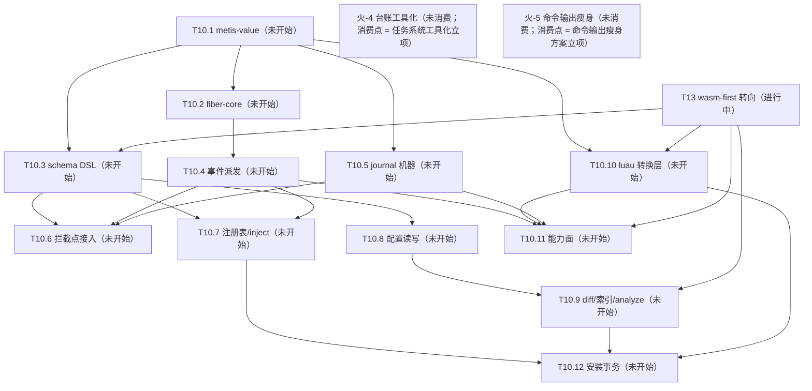

# Metis 台账（backlog）

> 状态：🔵 活跃（living；2026-10-14 立 = [ADR-0032](decisions/0032-operating-protocol.md)）。本文件 = 任务队列 + 遗留登记 + 火花区 + 全景图四位一体的**运行状态 SSOT**（git 追踪）。**临时方案**——长期需要一个工具承担任务状态管理，而非并发 agent 直接读写本文件（火-4；扩展位登记 = [operating-protocol](design/operating-protocol.md) §6）。

## 读写纪律

- agent 全权维护：任务块状态、进展、收官压行由 agent 在会话收尾更新，随当次 commit 入库，无需逐项请示。
- 维护者聊天驱动：任务开立、拍板、方向变更由维护者对话触发；agent 不自立任务。
- 任务粒度闸：任务在设计 / 开立时即过 [operating-protocol](design/operating-protocol.md) §2 任务粒度（切分三属性 + 验收单元容量预算），非待拆分才过；超阈值的处置 = 拆分，方案以议题批出示、合并拍板。
- 任务块状态行 = 状态词（AGENTS.md Reporting 十词）+ 已完成范围 + 下一步 + 未拍板项 + 评审面三数（拍板决策点数 / self-review findings 数 / 评审耗时量级——诊断位，不设门禁）。
- 任务生命周期状态 = 未开始 / 进行中 / 阻塞 / 已完成 + **延后（deferred）**：无限期延后，重开 = 维护者明示——延后是队列处置态，不进 Reporting 十词。
- 收官压单行与离库：任务收官后块压成单行（状态词 + 日期 + 产出指针 ADR+SHA），过程叙事溯源 = ADR 正文 + git 史；收官行 = 衔接过渡态，默认存活约一个任务周期——旧行清理走压缩仪式微缩版（下次收官或巡检时出示 → 维护者批准；[doc-lifecycle](design/doc-lifecycle.md) §7），deferred 行例外（队列处置态，留至重开或维护者明示丢弃）。
- 并发窗口一任务一写者：同一时刻一个任务块只有一个写者；并行窗口内每 agent 只写自己的任务块（[operating-protocol](design/operating-protocol.md) §3）——写冲突结构性规避，不靠锁。
- **注册先于执行（2026-10-15 维护者立，为以后所有任务/工作的前提）**：任何跨 session 的工作单元必须先在本台账登记为可续单元（任务块 / 下一步行 / 剩余工作清单），再执行；session 可随意中断，新 session 仅凭本台账续作——工作状态不以会话内记忆为载体。
- 文档结构性改动视同共享契约串行：本文件的节结构与任务块格式改动不走并行窗口。
- git 追踪原则（维护者原话）：「我们不能依赖任何非 git 追踪的文件。不然会非常容易出现悬垂指针，导致文档腐烂。」——运行状态一律 git 追踪；外部服务只作对外接口（GitHub Issues 不迁队列、不建 label；外部事项被采纳时才以链接条目进本台账，单写者、无双向同步）。

## 全景图（活跃任务 + 未消费火花；任务或火花变更时重生成）

图 = 派生视图（内容 SSOT = 任务块与火花登记区）：只画活跃面（未开始 / 进行中 / 阻塞）+ 未消费火花节点（label = 火-N + 短语 + 消费点）；已完成 / 延后节点离图，已满足依赖不画边（满足态住任务块「依赖」行）；边 = 传递归约后的硬依赖（无路径相连 = 结构可并行面）。

## 内部任务

活跃任务一任务一块（状态词 / 依赖 / 进展状态行含评审面三数 / 产出指针）；收官或延后任务压单行（见末节记录）。

### T10 实现

- 状态：**进行中**（T10.0b ✅ 2026-10-16（验收 = 维护者明示收尾，抽检配额未执行在案）；已完成 = Q1–Q11 拍板固化 + 0a 六件（gate-guard 机器闸 / machete 进 lint / llvm-cov 工具链 / cov-floor 空地板闸 / testing-ledger + test-telemetry / insta 语料孤儿闸）+ Q10/Q11 + station-run 增补「收官不自动开下一站」+ 0b 一件（`just deep` 慢轨 recipe = llvm-cov 工作区报告 + 膨胀遥测腿，本地按需；远程周跑 workflow 与自动开 issue 机制仍归 T10.2）；下一步 = 等维护者开启下一站（开启节奏归维护者）；未拍板项 = 无）
- 依赖：T11（✅ 2026-10-14）/ T12（✅ 2026-10-14 = [ADR-0033](decisions/0033-doc-lifecycle.md)）——开工门槛全备
- 站表（依赖列 = 硬依赖，即不可提前的并行面边界；清单锚点指向各 doc 登记原位不转抄；除 T10.0a/b 外每站自带 F 类写实清单（D8）；内核 crate 站自带 D11 测试来源声明 + llvm-cov 地板线（首钉 = T10.1））：
  - T10.0a 质量基建·快轨与机器闸 ✅（2026-10-16 验收；维护者明示收尾、抽检配额未执行在案；SHAs = c40ad79…0c632a4）——门禁面（justfile / `.pre-commit-config.yaml` / rust-toolchain.toml / crates/xtask）；依赖：无（非硬阻塞，后续站消费其门禁件故推荐最先）；清单 = [ADR-0031](decisions/0031-testing-strategy.md) Consequences 实现期清单（指针不转抄）；拍板形态（2026-10-15，Q2–Q5/Q7/Q8）= xtask `gate-guard`（commit trailer 机器闸；§4.2 清单 xtask 硬编码 + 注释指回散文 SSOT）+ AGENTS.md NEVER 增补 / cargo-machete 进 `just lint` / cargo-llvm-cov + rust-toolchain `llvm-tools-preview` 组件 / xtask `cov-floor` + `.config` 空地板文件（登记进 §4.2 修订注）/ `docs/testing-ledger.md` + xtask `test-telemetry`（增长率历史不做）/ `insta --unreferenced=auto` 进 `just ci`；追加（2026-10-15 Q10 拍板）= deny.toml duplicate skip 静音基线 + `-D unmatched-skip` fuse（随批落地，非 ADR-0031 原清单项）；HARD 人审门，依赖件逐项走 adding-dependencies。
  - T10.0b 质量基建·慢轨件 ✅（2026-10-16 验收；维护者明示收尾、抽检配额未执行在案；SHAs = b9c0e69…8880e7d）——`just deep` recipe（本地）；依赖：T10.0a（✅ 2026-10-16）；拍板形态（2026-10-15，Q1/Q6）= 首批内容 = llvm-cov 报告 + 膨胀遥测件（非空 recipe；§2.4/§5 原触发器提前，修订注在案）；远程周跑 workflow 与慢轨失败自动开 issue 机制推迟至 T10.2 随 mutants 首个硬门禁件落地。
  - T10.1 metis-value——`crates/metis-value`；依赖：无；锚 = ADR-0015/0022 + luau-abi §A6.3/§A6.8 登记表；Bytes 扩展位保留不立（context-events §3 方案 C 行）。
  - T10.2 metis-fiber-core——`crates/metis-fiber-core`（禁 tokio/mlua）；依赖：T10.1；锚 = ADR-0010/0019/0023 + fiber.md §10 开放项（SIGTERM 处理 / drain 总预算数值）+ luau-abi §A4.6 登记表（exclusive 名字回收 D1.2 / wait-for 图 D1.7）与实现期配置行（在飞协程预算与事件在途投递界 D10.2 / 优雅窗口 + drain 预算 D11.1）；随站 = Kani（D7）+ mutants 门禁（D4）+ D6 fiber 内存件；另随本站落地 = 远程周跑 workflow 首建（碰 `.github/workflows/`，ADR-0031 已授权）+ 慢轨失败自动开 issue 机制（2026-10-15 Q1/Q6 拍板划入）。
  - T10.3 schema DSL——`crates/metis-loader`；依赖：T10.1；锚 = luau-abi §A7.0（YAML parser 选型，走 adding-dependencies）/ §A7.1 D16.2 / §A7.3 D18.3 / §A7.4 D19.1 / §A7.5 与 §A8.5 登记表（表达式串 parser / 规范化比较器 / 命名空间合并解析器 / 启用期对账器 / 反向索引 D22.6 / 记忆化预算）。
  - T10.4 事件系统派发——`crates/metis-runtime`；依赖：T10.2；锚 = ADR-0011/0013/0014/0016/0017 + context-events.md §0.3 修订注（背压面写实 + worker 伪码语义更新两件实现期登记）+ luau-abi §A4.2（tokio 可学结构）/ §A4.6 表（裸 yield 检测 D9.3）；随站 = D6 事件吞吐件。
  - T10.5 journal 机器——`crates/metis-runtime`；依赖：T10.1；锚 = journal.md J1.6/J3.6/J4.4 实现期清单行（存活 10 项）+ luau-abi §A6.7 D7.3（JSONL + Int 字符串惯例）/ §A6.2（深快照预算数值）；D5 快照纪律随站。
  - T10.6 拦截点接入——`crates/metis-runtime`；依赖：T10.3 / T10.4 / T10.5；锚 = journal.md D82/D84（拦截点骨架形态；范围 = router / 生命周期机两族）+ luau-abi §A8.5 表（emit 校验器 D22.4 / internal/ emit 拦截 D20.2）；**能力使用族与 VM 族拦截（挂载位 = ctx 方法）划出本站 = T10.11**。
  - T10.7 服务注册表/inject——`crates/metis-runtime`；依赖：T10.2 / T10.3 / T10.4；锚 = service-registry.md S1–S6 机制本体（扩展位 5 处不做：withdraw / host 有界等待 / 跨 VM 取消 / check 谓词 / 自动重试）+ instance-model.md S3.7/S4.8 登记（D61/D63/D64/D68/D70/D72）+ luau-abi §A9.2（对账五格 D25 / warn 日志点 D25.1 / required 依赖图 D25.4）/ §A1.4（加载墙钟预算数值）+ config-format.md D43 级联执行半（与 T10.9 检测半汇合）；开工核对 = service-registry §3/§7 两格兑现抽查；**最大站——开工先过粒度闸，超阈值处置 = 拆 7a registry 本体 / 7b 实例与 mount 面**。
  - T10.8 配置读写管线——`crates/metis-loader` + runtime 胶水；依赖：T10.3；锚 = config-format.md C1–C3/C5/C6/C8 各章联动登记（D29 脚手架两件 / D36 读管线 / D39 原子写与串行队列 / D40 行块补丁器 / D47 secrets 内存 map 与两分 / C8 core 节容器校验）+ instance-model.md D67（实例配置合成器）。
  - T10.9 diff/reload + 部署索引——`crates/metis-loader`；依赖：T10.8；锚 = config-format.md C4/C7/C9 联动登记（D41 diff 器 / D42 重入与结构相等 / D43 检测半 / D34 部署索引扫描含残迹 / D52 analyze 判环 / 显式 reload 命令形态）+ luau-abi §A8.5（部署契约索引）/ §A9.1 D24（部署索引）/ §A10 登记表（AST 选型 D28.2 / luau-lsp 钉版 / 四生成器减 WIT / abi_rev 比较 D27.2）+ instance-model.md S2.6（fleet 校验 D56/D60）；**收窄 = 静态/纯算法面，生效动作执行（重挂载 / 级联重启用 / 卸载生效）划出 = T10.7 启用管线与 T10.12 汇合**。
  - T10.10 metis-luau 转换层——`crates/metis-luau`；依赖：T10.1；锚 = luau-abi §A3.11（mlua 无条件安装件处置）/ §A4.6 表（coroutine shim 的 mlua resume/yield 链 spike + 开销实测 D9.2 / shim + SENTINEL 环境准备）/ §A6.1（push_int64_exact）/ §A6.8 表 + seam-capabilities.md §1.4（环境准备同批）/ §1.6（数字格式化与 table 遍历序断言）/ §3.3（内存限额数值 + 单 VM 基线实测）/ §6.3；spike 先行。
  - T10.11 能力面——`crates/metis-runtime` 能力实现 + metis-luau ctx 暴露；依赖：T10.4 / T10.5 / T10.10；锚 = seam-capabilities.md（ADR-0025 机制本体：fs/http/sqlite/timer/process）+ §2.1（有界微基准）+ luau-abi §A3.6–§A3.10（能力预算数值 + TOCTOU 硬化）/ §A6.4 D4.3（UTF-8 校验）/ §A6.5 D5.4/D5.5（流式句柄族 + 宿主缓冲预算）+ journal 能力使用族 / VM 族拦截（自 T10.6 划入，挂载位 = ctx 方法）。
  - T10.12 安装事务——`crates/metis-loader` + runtime 协调；依赖：T10.7 / T10.8 / T10.9 / T10.10；锚 = ADR-0008（审批门 v1 接口预留不实现）+ luau-abi §A4.5 D11.5（cordis 事务式重载纪律）+ config-format.md C7（D48/D49 卸载两档）+ testing-strategy.md §3.F（F 类基建落地，failpoint 选型走 adding-dependencies）+ D6 热更件。
- 范围外（触发器未满足）：metis-codec TLV 位分配（luau-abi §A6.6 D6.2）与盒 trap 句柄处置（§A5.3 D14.4）——首盒发布前冻结即可；registry 扩展位 5 处 / context-events §0.5 优化位与 §3 Bytes 扩展位 / WIT 生成器（盒面）/ `metis install` 工具化与分发机制（长回）。
- 开窗前置：worktree bootstrap 自动化（[ADR-0032](decisions/0032-operating-protocol.md) Consequences 登记，届时再建）。
- 评审面三数：拍板 21（2026-10-15 拆分批 Q1–Q6 + T10.0 批 Q1–Q9 + Q10/Q11 + 验收包四项：bddb55b 保留不重置 / flake.nix 不入 §4.2 / 推送归并行会话 / 暂存规则不立——并行同工作区为特殊态）/ self-review findings 23（站表 pass 7 已随块修复；0a 批 8 笔 commit 判断 pass 共产出 14 Required 随笔修复；llvm-cov / insta 两笔判断 pass 漏跑、事后追认 pass = clean，流程漏记一条在案；0b 批 2 Required（backlog 随行 + Gate-Surface trailer，均落地形态项随笔处置）+ 1 Nit / 1 Optional 推回在案）/ 耗时 <1h ×2（0a/0b 均验收会话即收尾，抽检配额未执行）
- **2026-10-15 方向变更注**：wasm-first 转向拍板（= T13，维护者对话）——T10.3 / T10.9 / T10.10 / T10.11 的 Luau 锚点失效，待 T13 重规划后修订；T10.0a/b 与 T10.1/2/4/5/6/7/8/12 的语言无关面继续有效，T10.0a 实现批不受阻塞。

### T13 wasm-first 转向

- 状态：**进行中**（已完成 = 方向拍板消化 + ADR-0034 批次（0021/0026 整篇 supersede、0024 局部、luau-abi 归档、wit-abi 开章、AGENTS.md 清单）+ S1 spike **PASS**（证据 = wasm-research 补遗 6）——W1 风险解除为可绕行摩擦项；本批变更已提交（2026-10-15 = `f5bdc7c`）+ T13-g 设计重审 **已完成**（2026-10-16，产出 = [wasm-first-design-review](research/wasm-first-design-review.md)：A 消亡 10 项 / B 更优 9 项 / C 不动 10 项 / D 新机会 4 项 / E 硬张力 5 题 + T13-b/f 修订建议）；下一步 = 维护者拍板 E1–E5 议题批 + T13-f 范围扩充批，随后进 T13-b 站表修订；未拍板项 = E1–E5（报告 §6）+ 站级重规划细节 / SDK 形态 / 构建管线方案）
- 剩余工作注册（每项 = 新 session 仅凭本台账即可续作的最小单元；开工输入列 = 续作锚点）：
  - T13-a 提交转向批 — **已完成**（2026-10-15 = `f5bdc7c`；just ci 绿 + self-review 判断 pass 4 Required 修复后提交；钩子全过 = fmt/lint/secret scan/commit-msg/gate-guard）。
  - T13-b T10 站表修订批：T10.3/9/10/11 修订 + 新增 SDK/构建管线站 + 空壳 crate `crates/metis-luau` 处置（删除或改向 metis-component）；依赖 = T13-a；开工输入 = [ADR-0034](decisions/0034-wasm-first-carrier.md) §8 + 补遗 6。
  - T13-c wit-abi W4 章（async 与交错语义）：依赖 = T13-a；开工输入 = 补遗 6（S1 矩阵 + papercuts）+ [luau-abi](design/luau-abi.md) §A4（语义平移源，已归档仅考古读）。
  - T13-d SDK 形态议题（metis-plugin crate 宏形状 / 作者面）：依赖 = 无硬依赖（可与 b/c 并行）；开工输入 = ADR-0034 §4 + 先例清单（proxy-wasm SDK / zed_extension_api / Spin / Extism PDK 宏藏 ABI 模式）。
  - T13-e 构建管线方案（`metis dev` watch / 构建缓存 / 部署内工具链服务 / 远端构建场）：依赖 = 无硬依赖；开工输入 = ADR-0034 §6。
  - T13-f Luau 措辞修订批（seam-capabilities / context-events / instance-model 修订注 + ADR-0008 地位复审议题）：依赖 = 无硬依赖；来源 = ADR-0034 遗留议题登记。**范围扩充建议（T13-g 产出，待拍板）**：扩为 f1 living doc 批（+ fiber / config-format / service-registry）+ f2 冻结 ADR 处置批（ADR-0003/0019 机制死亡 supersede、0015/0022/0005/0011 rationale 换血，可并入 W 章批）；明细 = 报告 §7。
  - T13-g 设计重审（Luau 妥协面盘点）— **已完成**（2026-10-16 = [wasm-first-design-review](research/wasm-first-design-review.md)；待拍板 = E1–E5 议题批 + T13-f 扩充批，拍板结果消费进 T13-b/c/d/f）
- 维护者拍板约束原话 = [ADR-0034](decisions/0034-wasm-first-carrier.md) Context 末节（verbatim SSOT；本行曾逐字留存，ADR 批次消费后按冗余纪律删除，逐字原文见 git 史）
- 范围：ADR-0021 整篇 supersede + ADR-0024 局部（盒管模型收敛为单层组件 + 内建件 + 外部服务 + T2 例外）+ ADR-0026 整篇 supersede（luau-abi.md 归档 archived，doc-lifecycle 纪律）+ WIT ABI 重设计（A 系列语义平移，A4 挂起/交错重做 = 最高风险章）+ T10 站表重规划（T10.3/9/10/11 修订 + 新增 SDK/构建管线站）+ S1 spike（guest async 工效学，按补遗 5 §5.3 修订为「工效学验证」）
- 证据基线：[wasm-research 补遗 5](research/wasm-research.md)（wit-bindgen 0.63 async 正式特性 / wasip3 0.9.0+wasi-0.3.0 / wasip3 target Tier 3 入树 / 零拷贝语义四层修正 / Extism 判决 = 参照非选项）；ADR-0008（Creator 模式）前提削弱，审批门 v1 接口预留（T10.12 在案）不受影响，Creator 直写通道关闭须在新 ADR 明示

### 收官与延后记录（单行）

- T9 marketplace 格式设计 — **deferred**（2026-10-14 维护者裁定：无限期延后；重开条件 = 维护者明示）。

## 外部事项

（空）GitHub Issues = 对外接口本位：不建 label、不把队列迁 issue；外部事项被采纳时才以「链接条目」进本台账（单写者、无双向同步）——ADR-0032。

## 遗留问题登记

- **默认插件集**（开箱即用参考实现）——原则已定（ADR-0024 §4）；shell tool / schedule 插件候选在案；核心设计链已收官，可立项。
- **global 核心数据根可达性复审**（self-review 提出）：若收紧，改 luau-abi §A3.7 一行。
- **Value::Bytes 提正触发器**（A6.4）：首个跨插件二进制消费者 → 走 ADR 演进。
- **秘密引用限审批档收紧裁量**（D67 明记代价；维护者裁量未做）。
- **org 级「允许 Actions 开 PR」开关**：org Settings → Actions → General → Workflow permissions 勾开（repo 级随后同开），或 `gh auth refresh -h github.com -s admin:org` 后走 API；未开前 flake-update / toolchain-update 周更在开 PR 一步 403，其余 CI 不受影响。

各类**扩展位/复审触发器**均已在对应 ADR/设计文档内登记（SSOT 原位不动，不迁）。

## 火花登记区

机制 = AGENTS.md Style 节 spark-capture 规则：引文逐字登记不压缩；消费 = 内容升格固化进对应 docs/ 或代码，条目即从本区删除（去向处即 SSOT 不留痕，本台账 git 史保底）；未消费不静默消失；议题出示前回读本区。

- 火-4（2026-10-14；消费点 = 任务系统工具化立项，未消费）：「先做临时方案吧，后面我们应该需要一个工具去做这个事情，而不是让并发的agent去读写这个内容。」；上下文锚 = 任务 11 改稿拍板回复（本台账定调）
- 火-5（2026-10-15；消费点 = 命令输出瘦身方案立项（质量基建扩展或独立任务），未消费）：「我们一些高频调用的命令，如 just 系列，just ci 之类的，我们在成功时并不关心其详细的输出，只在错误时才希望有详细的输出。并且冗余的输出也会污染agent的上下文。这里后续希望能探索一个有效的方案，用来简化这些输出。」；上下文锚 = T10.0 开工会话（Q1–Q9 拍板同回复附带；候选方向 = 成功静默/失败详输的包装、日志落盘 + 尾行摘要、工具静默旗标盘点）
