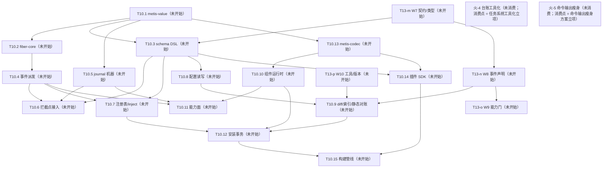

# Metis 台账（backlog）

> 状态：🔵 活跃（living；2026-10-14 立 = [ADR-0032](decisions/0032-operating-protocol.md)）。本文件 = 任务队列 + 遗留登记 + 火花区 + 全景图四位一体的**运行状态 SSOT**（git 追踪）。**临时方案**——长期需要一个工具承担任务状态管理，而非并发 agent 直接读写本文件（火-4；扩展位登记 = [operating-protocol](design/operating-protocol.md) §6）。

## 读写纪律

- agent 全权维护：任务块状态、进展、收官压行由 agent 在会话收尾更新，随当次 commit 入库，无需逐项请示。
- 维护者聊天驱动：任务开立、拍板、方向变更由维护者对话触发；agent 不自立任务。
- 任务粒度闸：任务在设计 / 开立时即过 [operating-protocol](design/operating-protocol.md) §2 任务粒度（切分三属性 + 验收单元容量预算），非待拆分才过；超阈值的处置 = 拆分，方案以议题批出示、合并拍板。
- 任务块状态行 = 状态词（AGENTS.md Reporting 十词）+ 已完成范围 + 下一步 + 未拍板项 + 评审面三数（拍板决策点数 / self-review findings 数 / 评审耗时量级——诊断位，不设门禁）。
- 任务生命周期状态 = 未开始 / 进行中 / 阻塞 / 已完成 + **延后（deferred）**：无限期延后，重开 = 维护者明示——延后是队列处置态，不进 Reporting 十词。
- 收官压单行与离库：任务收官后块压成单行（状态词 + 日期 + 产出指针 ADR+SHA），过程叙事溯源 = ADR 正文 + git 史；收官行 = 衔接过渡态，默认存活约一个任务周期——旧行清理走压缩仪式微缩版（下次收官或巡检时出示 → 维护者批准；[doc-lifecycle](design/doc-lifecycle.md) §7），deferred 行例外（队列处置态，留至重开或维护者明示丢弃）。
- 并发窗口一任务一写者：同一时刻一个任务块只有一个写者；并行窗口内每 agent 只写自己的任务块（[operating-protocol](design/operating-protocol.md) §3）——写冲突结构性规避，不靠锁。
- **注册先于执行（2026-10-15 维护者立，为以后所有任务/工作的前提）**：任何跨 session 的工作单元必须先在本台账登记为可续单元（任务块 / 下一步行 / 剩余工作清单），再执行；session 可随意中断，新 session 仅凭本台账续作——工作状态不以会话内记忆为载体。
- 文档结构性改动视同共享契约串行：本文件的节结构与任务块格式改动不走并行窗口。
- git 追踪原则（维护者原话）：「我们不能依赖任何非 git 追踪的文件。不然会非常容易出现悬垂指针，导致文档腐烂。」——运行状态一律 git 追踪；外部服务只作对外接口（GitHub Issues 不迁队列、不建 label；外部事项被采纳时才以链接条目进本台账，单写者、无双向同步）。

## 全景图（活跃任务 + 未消费火花；任务或火花变更时重生成）

图 = 派生视图（内容 SSOT = 任务块与火花登记区）：只画活跃面（未开始 / 进行中 / 阻塞）+ 未消费火花节点（label = 火-N + 短语 + 消费点）；已完成 / 延后节点离图，已满足依赖不画边（满足态住任务块「依赖」行）；边 = 传递归约后的硬依赖（无路径相连 = 结构可并行面）。

## 内部任务

活跃任务一任务一块（状态词 / 依赖 / 进展状态行含评审面三数 / 产出指针）；收官或延后任务压单行（见末节记录）。

### T10 实现

- 状态：**进行中**（T10.0b ✅ 2026-10-16（验收 = 维护者明示收尾，抽检配额未执行在案）；已完成 = Q1–Q11 拍板固化 + 0a 六件（gate-guard 机器闸 / machete 进 lint / llvm-cov 工具链 / cov-floor 空地板闸 / testing-ledger + test-telemetry / insta 语料孤儿闸）+ Q10/Q11 + station-run 增补「收官不自动开下一站」+ 0b 一件（`just deep` 慢轨 recipe = llvm-cov 工作区报告 + 膨胀遥测腿，本地按需；远程周跑 workflow 与自动开 issue 机制仍归 T10.2）；下一步 = 等维护者开启下一站（开启节奏归维护者）；未拍板项 = 无）
- 依赖：T11（✅ 2026-10-14）/ T12（✅ 2026-10-14 = [ADR-0033](decisions/0033-doc-lifecycle.md)）——开工门槛全备
- 站表（依赖列 = 硬依赖，即不可提前的并行面边界；清单锚点指向各 doc 登记原位不转抄；除 T10.0a/b 外每站自带 F 类写实清单（D8）；内核 crate 站自带 D11 测试来源声明 + llvm-cov 地板线（首钉 = T10.1））：
  - T10.0a 质量基建·快轨与机器闸 ✅（2026-10-16 验收；维护者明示收尾、抽检配额未执行在案；SHAs = c40ad79…0c632a4）——门禁面（justfile / `.pre-commit-config.yaml` / rust-toolchain.toml / crates/xtask）；依赖：无（非硬阻塞，后续站消费其门禁件故推荐最先）；清单 = [ADR-0031](decisions/0031-testing-strategy.md) Consequences 实现期清单（指针不转抄）；拍板形态（2026-10-15，Q2–Q5/Q7/Q8）= xtask `gate-guard`（commit trailer 机器闸；§4.2 清单 xtask 硬编码 + 注释指回散文 SSOT）+ AGENTS.md NEVER 增补 / cargo-machete 进 `just lint` / cargo-llvm-cov + rust-toolchain `llvm-tools-preview` 组件 / xtask `cov-floor` + `.config` 空地板文件（登记进 §4.2 修订注）/ `docs/testing-ledger.md` + xtask `test-telemetry`（增长率历史不做）/ `insta --unreferenced=auto` 进 `just ci`；追加（2026-10-15 Q10 拍板）= deny.toml duplicate skip 静音基线 + `-D unmatched-skip` fuse（随批落地，非 ADR-0031 原清单项）；HARD 人审门，依赖件逐项走 adding-dependencies。
  - T10.0b 质量基建·慢轨件 ✅（2026-10-16 验收；维护者明示收尾、抽检配额未执行在案；SHAs = b9c0e69…8880e7d）——`just deep` recipe（本地）；依赖：T10.0a（✅ 2026-10-16）；拍板形态（2026-10-15，Q1/Q6）= 首批内容 = llvm-cov 报告 + 膨胀遥测件（非空 recipe；§2.4/§5 原触发器提前，修订注在案）；远程周跑 workflow 与慢轨失败自动开 issue 机制推迟至 T10.2 随 mutants 首个硬门禁件落地。
  - T10.1 metis-value——`crates/metis-value`；依赖：无；锚 = ADR-0015/0022 + luau-abi §A6.3/§A6.8 登记表；Bytes 已提正 = [ADR-0042](decisions/0042-value-bytes.md)（W6 D158）。
  - T10.2 metis-fiber-core——`crates/metis-fiber-core`（禁 tokio/mlua）；依赖：T10.1；锚 = ADR-0010/0019/0023 + fiber.md §10 开放项（SIGTERM 处理 / drain 总预算数值）+ luau-abi §A4.6 登记表（exclusive 名字回收 D1.2 / wait-for 图 D1.7）与实现期配置行（在飞协程预算与事件在途投递界 D10.2 / 优雅窗口 + drain 预算 D11.1）；随站 = Kani（D7）+ mutants 门禁（D4）+ D6 fiber 内存件；另随本站落地 = 远程周跑 workflow 首建（碰 `.github/workflows/`，ADR-0031 已授权）+ 慢轨失败自动开 issue 机制（2026-10-15 Q1/Q6 拍板划入）。
  - T10.3 schema DSL——`crates/metis-loader`；依赖：T10.1；锚 = luau-abi §A7.0（YAML parser 选型，走 adding-dependencies）/ §A7.1 D16.2（记法与产生式冻结纪律）/ §A7.3 D18.3（规范化比较器）/ §A7.4 D19.1（运行期 walk 校验器 = 宿主两跳中点原位存活）/ §A7.5 与 §A8.5 登记表（表达式串 parser / 命名空间合并解析器 / 启用期对账器 / 反向索引 D22.6 / 记忆化预算）——A7 半消融 = E5 拍板：记法裁至只服务 Value 形状（`buffer`/`function` 等 ctx 面词族消亡），config schema `type:` 接线与契约包三来源存活；新增 = WIT 包加载与契约命名空间合并（wit-parser 系选型走 adding-dependencies；契约包数据职能的 WIT 继承面 = design-review A2 存活物）+ 平台封闭接口面 WIT 富类型契约（三分法①）；形态定稿锚 = wit-abi W2/W7 章。
  - T10.4 事件系统派发——`crates/metis-runtime`；依赖：T10.2；锚 = ADR-0011/0013/0014/0016/0017 + context-events.md §0.3 修订注（背压面写实 + worker 伪码语义更新两件实现期登记）+ luau-abi §A4.2（tokio 可学结构）/ §A4.6 表（裸 yield 检测 D9.3）；随站 = D6 事件吞吐件。
  - T10.5 journal 机器——`crates/metis-runtime`；依赖：T10.1；锚 = journal.md J1.6/J3.6/J4.4 实现期清单行（存活 10 项）+ luau-abi §A6.7 D7.3（JSONL + Int 字符串惯例）/ §A6.2（深快照预算数值）+ W6 D158（`Bytes` JSONL = base64 包裹）；D5 快照纪律随站。
  - T10.6 拦截点接入——`crates/metis-runtime`；依赖：T10.3 / T10.4 / T10.5；锚 = journal.md D82/D84（拦截点骨架形态；范围 = router / 生命周期机两族）+ luau-abi §A8.5 表（emit 校验器 D22.4 / internal/ emit 拦截 D20.2）；**能力使用族与 VM 族拦截（挂载位 = ctx 方法）划出本站 = T10.11**。
  - T10.7 服务注册表/inject——`crates/metis-runtime`；依赖：T10.2 / T10.3 / T10.4；锚 = service-registry.md S1–S6 机制本体（扩展位 5 处不做：withdraw / host 有界等待 / 跨 VM 取消 / check 谓词 / 自动重试）+ instance-model.md S3.7/S4.8 登记（D61/D63/D64/D68/D70/D72）+ luau-abi §A9.2（对账五格 D25 / warn 日志点 D25.1 / required 依赖图 D25.4）/ §A1.4（加载墙钟预算数值）+ config-format.md D43 级联执行半（与 T10.9 检测半汇合）；开工核对 = service-registry §3/§7 两格兑现抽查；**最大站——开工先过粒度闸，超阈值处置 = 拆 7a registry 本体 / 7b 实例与 mount 面**。
  - T10.8 配置读写管线——`crates/metis-loader` + runtime 胶水；依赖：T10.3；锚 = config-format.md C1–C3/C5/C6/C8 各章联动登记（D29 脚手架两件 / D36 读管线 / D39 原子写与串行队列 / D40 行块补丁器 / D47 secrets 内存 map 与两分 / C6.4 D135 共享变量解析 / C8 core 节容器校验）+ instance-model.md D67（实例配置合成器）。
  - T10.9 diff/reload + 部署索引——`crates/metis-loader`；依赖：T10.8；锚 = config-format.md C4/C7/C9 联动登记（D41 diff 器 / D42 重入与结构相等 / D43 检测半 / D34 部署索引扫描含残迹 / D52 analyze 判环 / 显式 reload 命令形态）+ luau-abi §A8.5（部署契约索引）/ §A9.1 D24（部署索引）+ instance-model.md S2.6（fleet 校验 D56/D60）——静态/纯算法面全存活；消亡 = 钉版 luau-lsp / AST 选型 / 四生成器（design-review A8）；换血 = `abi` 字段（WIT package version）比较（ADR-0034 §3 承接，D27.2 min 语义原位；W2 D132）+ 组件自描述进口清单解析进部署索引（D24.1 面扩展；启用期进口对账 = B1 编译期结构事实，判定面归 T10.7）+ emit 对账形状源 = 瘦身形状 DSL（E5）；**收窄 = 静态/纯算法面，生效动作执行（重挂载 / 级联重启用 / 卸载生效）划出 = T10.7 启用管线与 T10.12 汇合**。
  - T10.10 组件运行时——`crates/metis-component`（wasmtime 嵌入：Store/Instance 管理、实例即弃池化、fuel/epoch 预算、host imports 注册、wasm trap 处置接 fiber 错误遏制）；依赖：T10.1 / T10.13；锚 = ADR-0005（遏制四约束原生兑现 = design-review D2）+ wasm-research 补遗 5 §5.4（边界拷贝语义四层）/ 补遗 6（S1 矩阵 + papercuts）/ 补遗 10（S3 blob 跨实例句柄）/ wit-abi W1/W4/W5/W6 章（设计锚）；W6 增补 = 每实例 `ResourceTable`、blob 注册表（`Arc` + 引用计数）、跨 Store 句柄重物化、resource 析构与预算；wasmtime 引入走 adding-dependencies（ADR-0034 风险 W4）；原 Luau 锚点（push_int64_exact / coroutine shim spike / mlua 处置件）全失效，空壳 `crates/metis-luau` 已于 T13-b 批删除。
  - T10.11 能力面——`crates/metis-runtime` 能力实现 + metis-component host imports 暴露（ctx 面 = WIT imports，作者面 SDK 映射归 T10.14）；依赖：T10.4 / T10.5 / T10.10；锚 = seam-capabilities.md（ADR-0025 能力集语义本体存活：fs/http/timer/process；sqlite 撤回 = ADR-0039（DB = guest crate + private fs，无宿主句柄）；§1 stdlib 卫生章消亡 = design-review A1，清写归 T13-f）+ E4 修订两档（private = WASI 0.3 wasi:filesystem async（preopen，隐式读写）/ global = host-mediated 自研逃逸舱，manifest `fs: read|write` 声明；命名根撤回 = ADR-0039；workspace/session 语义归插件层服务投影，核心不做一一映射）+ luau-abi §A3.6–§A3.10（能力预算数值 + TOCTOU 硬化语义锚存活）/ §A6.5 D5.4/D5.5（流式句柄族语义存活，形态按 W6 的 byte-reader / byte-writer / blob 重做）+ design-review B2（纯算内建件族消解进 guest 包生态，核心收缩 = 效应能力 + wasi 标准件；crypto 撤回 = ADR-0041，guest crate + wasi:random；seam §2.1 微基准与 sync 白名单机器大半随之消亡）+ journal 能力使用族 / VM 族拦截（自 T10.6 划入，挂载位 = host import 实现侧）+ wit-abi W5（错误族 D137 与未声明能力 trap D139）+ W6 D159（`open-read` / `open-write` / `download` / blob 创建 / collect）；消亡 = §A6.4 D4.3 UTF-8 校验与 buffer 面（WIT `string`/`list<u8>` 原生）。
  - T10.12 安装事务——`crates/metis-loader` + runtime 协调；依赖：T10.7 / T10.8 / T10.9 / T10.10；锚 = ADR-0008（审批门 v1 接口预留不实现）+ luau-abi §A4.5 D11.5（cordis 事务式重载纪律）+ config-format.md C7（D48/D49 卸载两档）+ testing-strategy.md §3.F（F 类基建落地，failpoint 选型走 adding-dependencies）+ D6 热更件。
  - T10.13 metis-codec——`crates/metis-codec`（TLV 线编码 crate，双 target = 宿主与 guest 共用）；依赖：T10.1；锚 = luau-abi §A6.6 已拍板设计（`list<u8>` 进 / `result<list<u8>, list<u8>>` 出 / 格式版本字段）+ wit-abi W5（business data = TLV Value）+ W6 D156/D158（canonical 编码 / `ValueRef` / `encoded_len` + `encode_into` / bytes tag；blob 不进 TLV）——E1 选项① 拍板主线化（自范围外拨出，位分配冻结时点 = 首插件发布前原位）；D11 声明 + cov 地板 + round-trip 测试基线随站。
  - T10.14 插件 SDK——`crates/metis-plugin`（guest 侧官方 SDK，ADR-0034 §4：`#[metis::plugin]` 宏藏 ABI + trait 实现形态，作者不见 WASI/WIT；world 固定，能力白名单 = manifest 声明对账）；依赖：T10.1 / T10.3 / T10.13；锚 = 先例（proxy-wasm SDK / zed_extension_api / Spin / Extism PDK 宏藏 ABI 模式）+ 三分法②（瘦身形状 DSL → 具体 Rust 类型生成，`any` 回落 `metis::Value`）+ E3 拍板（宿主零同步原语：fanout = guest 异步设施原生、exclusive = SDK async mutex 助手；D1.2 三规则重估面随站）+ design-review B2（内建件便利 re-export = feature 面）+ WASI 0.3 基线导入 / world 收敛（补遗 9；wasip2 14 导入为历史）；开工输入 += [plugin-sdk](design/plugin-sdk.md)（T13-d 定案 S1–S7 = D98–D104）+ wit-abi W1/W3/W5/W6 章（W6 增补 = `Payload` / `Blob` / `ByteReader` / `ByteWriter` / `Value::Bytes` + typed decode）；D11 声明随站（guest 面形态随站定）。
  - T10.15 即写即用构建管线——`metis dev` watch 守护（保存 → 构建 → 热换 = 主答案）+ 构建缓存 + 脚手架模板；依赖：T10.12 / T10.14；锚 = ADR-0034 §6 四件（watch / 构建缓存 / 部署内工具链服务（可选件 = Creator 体面退场形态）/ 远端构建场（marketplace 配套，与确定性构建信任链同管线）——后两件触发器未满足，不进 v1 面）+ design-review B9（地板实测：增量重建 0.22–0.29 s + 实例化 1.7 µs）+ ADR-0034 风险 W3（WIT 包 SSOT + wit-bindgen/wasm-tools/wasmtime 钉版纪律）+ `metis sdk` 命令面重组（D28.1 存活件 = new/check 归本面与 T10.9 同实现；analyze 读代码扫描面消亡 = design-review B1）；开工输入 += [build-pipeline](design/build-pipeline.md)（D105–D115）+ [build-pipeline-survey](research/build-pipeline-survey.md)；W6 增补 = world import 集含 `blobs` / `streams` / `payloads`；F 类窗口 = build-pipeline §15（收官时迁入 testing-strategy §3.F）；D11 / cov-floor 若新增内核 crate 则按 station-run 义务。
- 范围外（触发器未满足）：registry 扩展位 5 处 / context-events §0.5 优化位 / `metis install` 工具化与分发机制（长回）。（2026-10-16 T13-b 拨出三件：metis-codec TLV 位分配 = E1 选项① 主线化提正归 T10.13；盒 trap 句柄处置随盒概念消解（ADR-0034 §2）归 T10.10 本体；WIT 生成器（盒面）随 Luau 工具面全撤消亡 = design-review A8。）
- 开窗前置：worktree bootstrap 自动化（[ADR-0032](decisions/0032-operating-protocol.md) Consequences 登记，届时再建）。
- 评审面三数：拍板 21（2026-10-15 拆分批 Q1–Q6 + T10.0 批 Q1–Q9 + Q10/Q11 + 验收包四项：bddb55b 保留不重置 / flake.nix 不入 §4.2 / 推送归并行会话 / 暂存规则不立——并行同工作区为特殊态）/ self-review findings 23（站表 pass 7 已随块修复；0a 批 8 笔 commit 判断 pass 共产出 14 Required 随笔修复；llvm-cov / insta 两笔判断 pass 漏跑、事后追认 pass = clean，流程漏记一条在案；0b 批 2 Required（backlog 随行 + Gate-Surface trailer，均落地形态项随笔处置）+ 1 Nit / 1 Optional 推回在案）/ 耗时 <1h ×2（0a/0b 均验收会话即收尾，抽检配额未执行）
- **2026-10-15 方向变更注**：wasm-first 转向拍板（= T13，维护者对话）——T10.3 / T10.9 / T10.10 / T10.11 已随 T13-b 修订（2026-10-16，另新增 T10.13/14/15 三站）；T10.0a/b 与 T10.1/2/4/5/6/7/8/12 的语言无关面继续有效。其余站线散见 Luau 子锚点开工核对四项：T10.2 的 exclusive 名字回收 D1.2 随 E3 拍板归 T10.14 SDK 助手面；T10.4 的裸 yield 检测 D9.3 消亡（guest async 运行时自管，design-review A7）；T10.8 的 D29 `.luaurc` 脚手架件消亡（require 体系全链 = A2）；T10.7 的盒对账格 D25.5 升格为全插件进口对账（B1，语义原位存活）。

### T13 wasm-first 转向

- 状态：**进行中**（已完成 = 方向拍板消化 + ADR-0034 批次（0021/0026 整篇 supersede、0024 局部、luau-abi 归档、wit-abi 开章、AGENTS.md 清单）+ S1 spike **PASS**（证据 = wasm-research 补遗 6）——W1 风险解除为可绕行摩擦项；本批变更已提交（2026-10-15 = `f5bdc7c`）+ T13-g 设计重审 **已完成**（2026-10-16，产出 = [wasm-first-design-review](research/wasm-first-design-review.md)：A 消亡 10 项 / B 更优 9 项 / C 不动 10 项 / D 新机会 4 项 / E 硬张力 5 题 + T13-b/f 修订建议）；拍板进展（2026-10-16 两轮）= E3 定（最大化并发投递、宿主零同步原语、同步归 guest 语言设施；澄清：实例内各任务共享同一堆，同步件 = await 间天然原子 + async mutex，原子变量无场景；同实例重入 = W4 开工首项 spike）+ E1/E2/E5 合并案定（接口数据三分法：平台封闭面 = WIT 富类型 / 开放数据面 = TLV + 瘦身形状 DSL + SDK 生成类型 / 大负载 = stream·resource）+ E4 定（fs；2026-10-19 收窄为 private 隐式 + `fs` 标量 global，命名根撤回 = ADR-0039；workspace/session 语义归插件层服务投影）+ T13-f 标准与两边界定（清写至零 Lua 痕迹；冻结 ADR 不动、luau-abi 保归档）；T13-b 站表修订批 **已完成**（2026-10-16：T10.3/9/10/11 按拍板结论修订 + 新增 T10.13 metis-codec / T10.14 插件 SDK / T10.15 构建管线三站 + 空壳 `crates/metis-luau` 删除、`crates/metis-component` 占位建立 + wit-abi 目录 W4/W6/W7 行对齐拍板；产出 = 本批 diff，验收归维护者评审）+ T13-c W4 章 ✅（2026-10-17：S2 同实例重入 spike **PASS** = 补遗 7，E3 吸收 = D93–D97 + ADR-0011 Status 注 + context-events §0/§1 清写）+ T13-d SDK 形态议题 ✅（2026-10-17：八项议题全按推荐拍板（七项形态定案 = D98–D104 + 第八项 = 固化去处），固化 = [plugin-sdk](design/plugin-sdk.md) 开章 D98–D104 + [sdk-precedent-survey](research/sdk-precedent-survey.md) 先例调研四路并行）+ T13-e 构建管线方案 ✅（2026-10-18：十一项议题全按推荐拍板（D105–D115；三项落地细节并入 D105/D106/D115），固化 = [build-pipeline](design/build-pipeline.md) 开章 + [build-pipeline-survey](research/build-pipeline-survey.md) 三路并行）+ T13-f Luau 痕迹清除批 ✅（2026-10-18：六篇载体面清写 + 历史修订注层压缩 + 全域 living doc 零 Lua 字面痕迹 + ADR-0035/0036 + ADR-0008 注）+ T13-h W1 章 ✅（2026-10-18：九项拍板 D116–D124 = 包布局与组件文件名（缺省 `plugin.wasm`，manifest 可指定）/ WIT 包与 world（`metis:plugin@0.1.0`，WIT 住 `crates/metis-plugin/wit/`）/ 生命周期导出集（`setup` / `on-config` / `dispose`，全 async，TLV 配置，错误类型归 W5）/ 入口时序与激活门 / setup 失败与加载预算 / dispose 调用位（卸载五段化）/ start 与命令组件拒绝 / 零仪式 ABI 面 / ADR-0005 成本账局部取代；产出 = [wit-abi](design/wit-abi.md) W1 章 + [ADR-0037](decisions/0037-component-instance-cost-ledger.md) + W4.5 五段化 + config-format/plugin-sdk/build-pipeline 联动行；just ci 绿 + self-review 三轮 4 Critical + 13 Required + 15 Nit + 4 Optional（Critical/Required 全修复，Nits 全采纳，Optional 3 采纳/1 保留）；验收 = 维护者 diff 评审）+ T13-i W2 章 ✅（2026-10-19：十项拍板 D125–D134 = manifest 形态与边界 / 顶层字段全集与身份（`name` 不立）/ `component` / `config` schema / `capabilities`（private 隐式 + `fs` 标量 global；sqlite 撤回）/ 命名根撤回 / `provides`-`inject`-`events` / `abi`-`version`-`description` / 校验模型与声明≠观察 / 模块系统消亡；产出 = [wit-abi](design/wit-abi.md) W2 章 + [ADR-0038](decisions/0038-module-system-require-supersede.md) + [ADR-0039](decisions/0039-fs-capability-two-tier.md) + [ADR-0040](decisions/0040-config-shared-variables.md)（共享变量，含 secret，2026-10-19 追加）+ 五篇联动行；just ci 绿 + self-review 两轮 4+2 Critical + 9+13 Required + 7+10 Nit + 1+5 Optional（Critical/Required 全修复，Nits 15/17 采纳，Optional 4/6 采纳）；验收 = 维护者 diff 评审）；T13-k W5 章 ✅（2026-10-19：六项拍板 D136–D141 = 错误类型形状（共享 record + 封闭 enum）/ 错误族清单（fs/http/process/service + core 两格；sql/box.trap 死亡）/ 方向性（guest 导出只许 business；非 business = core-contract-violation）/ 响亮 vs Result（静态作者错 = trap；运行期交互/形状失败 = core Err）/ business data = TLV + message 纪律 / 作者面投影（D102 不变 + A5 习语消亡）；产出 = [wit-abi](design/wit-abi.md) W5 章 + W1/W2/W4/seam/plugin-sdk/journal/service-registry 联动行；just ci 绿 + self-review 判断 pass 已完成（findings 见评审面三数）；验收 = 维护者 diff 评审）；T13-j W3 章 ✅（2026-10-19：十三项拍板 D142–D154 = 能力面判据（纯算件归 guest crate；crypto 撤回 = ADR-0041）/ metis import 集（events/services/timer/http/fs/process/instance）+ private fs = WASI 0.3 filesystem/ fs 两档统一 async（private = WASI 0.3 filesystem；global = host-mediated；fs-invalid-utf8 保留）/ timer sleep + after/every + on-timer（回调体在 wasm 内；RAII + 宿主账本；合并计数；不静默丢弃）/ events 宿主登记 + Listener RAII / services call+provide+deps+on-call（per-call deadline；provide 观测保留 S3 对账）/ http 富类型 / process resource / instance mount-handle / async-sync 分类 / 投递纪律 / Ctx 与句柄 / 能力门与 world 终态；产出 = [wit-abi](design/wit-abi.md) W3 章 + [ADR-0041](decisions/0041-crypto-capability-withdrawal.md) + 联动行；just ci 绿 + self-review 判断 pass 已完成（findings 见评审面三数）；验收 = 维护者 diff 评审）；T13-l W6 章 ✅（2026-10-19：八项拍板 D155–D162 = 拷贝纪律与热路径预算 / canonical binary Value 格式（TLV） / Value 映射与严格制 / `Value::Bytes` 提正 / 大负载双车道（blob 可跨实例只读 + byte-reader / byte-writer） / `payload` 变体 / resource 生命周期 / 失败面与 EOF；S3 spike **PASS** = 补遗 10（跨 Store blob 句柄重物化 + variant 内嵌 `own<blob>`）；产出 = [wit-abi](design/wit-abi.md) W6 章 + [ADR-0042](decisions/0042-value-bytes.md) + [ADR-0043](decisions/0043-blob-two-lane-payload.md) + ADR-0015/0022 Status 注 + W1/W3/W4/W5/W8/W9/W10/seam/plugin-sdk/instance-model/context-events 联动；just ci 绿 + self-review 判断 pass 已完成（findings 见评审面三数）；验收 = 维护者 diff 评审）；下一步 = 剩余 W 章 = T13-m/p（n 待 m、o 待 n；开启节奏归维护者）；W7（m 已解锁）/ W8（待 m）/ W9（待 n）有章序依赖（见全景图）；未拍板项 = 无）
- 剩余工作注册（每项 = 新 session 仅凭本台账即可续作的最小单元；开工输入列 = 续作锚点）：
  - T13-a 提交转向批 — **已完成**（2026-10-15 = `f5bdc7c`；just ci 绿 + self-review 判断 pass 4 Required 修复后提交；钩子全过 = fmt/lint/secret scan/commit-msg/gate-guard）。
  - T13-b T10 站表修订批 — **已完成**（2026-10-16；产出 = T10.3/9/10/11 修订 + T10.13/14/15 新增 + 空壳 crate 处置 + wit-abi 目录行对齐 + 范围外拨出三件，同批 diff 一处看全；just ci 绿 + self-review 判断 pass 3 Required 随笔修复；验收 = 维护者 diff 评审）。
  - T13-c wit-abi W4 章（async 与交错语义）— **已完成**（2026-10-17；产出 = [wit-abi](design/wit-abi.md) W4 章 D93–D97 收官 + S2 同实例重入 spike **PASS**（证据 = [wasm-research](research/wasm-research.md) 补遗 7：R1 重入交错实证 / R2 共享堆与丢失更新 / R4 在飞遗弃观察 + papercuts 7–11）+ ADR-0011 Status 局部 supersede 注（`lua_State` 与 interrupt 时间盒格载体面 = f2 吸收兑现）+ context-events §0/§1 清写（f1 面随批）+ wit-abi §0 术语锚点与目录行；just ci 绿 + self-review 判断 pass；验收 = 维护者 diff 评审）。
  - T13-d SDK 形态议题（metis-plugin crate 宏形状 / 作者面）— **已完成**（2026-10-17：八项议题批全按推荐拍板（七项形态定案 = D98–D104 + 第八项 = 固化去处）；固化 = [plugin-sdk](design/plugin-sdk.md) 开章 S1–S7（D98–D104：作者面骨架 struct+trait / 绑定生成 Zed 式住 SDK crate / 拓扑与钉版 / 全 async 面 / 错误三格封套 / 「world 固定」释读与能力映射三原则 / `types!()` 时序）+ [sdk-precedent-survey](research/sdk-precedent-survey.md)（四先例宏藏 ABI 机制，四路并行子代理调研）+ AGENTS.md 清单；just ci 绿 + self-review 判断 pass（1 Required + 1 Nit 均随笔修复）；验收 = 维护者 diff 评审）。
  - T13-e 构建管线方案（`metis dev` watch / 构建缓存 / 部署内工具链服务 / 远端构建场）— **已完成**（2026-10-18：十一项议题全按推荐拍板（D105–D115；三项落地细节并入 D105/D106/D115）；固化 = [build-pipeline](design/build-pipeline.md) 开章 + [build-pipeline-survey](research/build-pipeline-survey.md)（dev loop / 构建缓存 / 远端构建场三路并行先例调研）；just ci 绿 + self-review 判断 pass（3 Critical + 18 Required + 9 Nit + 4 Optional，均按修复/登记处置）；轻巡检：agent-check 绿；freshness 已随本批 bump；无新增冗余候选 / TODO 滞留 / 零维护文档；验收 = 维护者 diff 评审）。
  - T13-f Luau 痕迹清除批（标准 = **清写至零 Lua 痕迹**：living 设计文档重写为只讲当前设计，新人无需知道 Lua 存在过；非修订注考古——修订注层随清写吸收，历史住 git 史与冻结 ADR；冻结 ADR 正文不动，机制死亡者走 supersede；luau-abi 保归档不删）— **已完成**（2026-10-18；f1 六篇清写 + 历史修订注层压缩 = seam-capabilities 按 wasm 能力面与 E4 fs 三层重写 / context-events payload 与通道论据换载体 / instance-model 组件实例与契约面重指 + 五站历史层压缩 / fiber 错误遏制层换 wasm / config-format 布局、`on_config` 与工具面命令清写 + 九章历史层压缩 / service-registry 契约包体系与并发条款重写；全域 living doc 零 Lua 字面痕迹（归档 luau-abi 与 archived session-model 除外）；f2 兜底 = journal `fanout_cancelled` supersede = [ADR-0035](decisions/0035-journal-fanout-cancelled-supersede.md) + ADR-0008 地位复议注（审批管线保留，直写前提局部 supersede = ADR-0034 §1；校验步换血 = build-pipeline D108）；fs 三层固化 = [ADR-0036](decisions/0036-fs-scope-three-layers.md)（局部 supersede ADR-0027 D44 / ADR-0025 §5.2 两档格）；f2 已分配项（ADR-0005/0003/0015·0022/0019 C3/0011）仍随 W 章吸收，f 不单独执行；just ci 绿 + self-review；验收 = 维护者 diff 评审）
  - T13-g 设计重审（Luau 妥协面盘点）— **已完成**（2026-10-16 = [wasm-first-design-review](research/wasm-first-design-review.md)；E1–E5 与 T13-f 扩充批已于 2026-10-16 两轮拍板，消费去向 = T13-b（已消费）/ T13-c/d/f（随各件开工消费））
  - T13-h wit-abi W1 章（插件包形态与入口契约）— **已完成**（2026-10-18；九项拍板 D116–D124；产出 = [wit-abi](design/wit-abi.md) W1 章 + [ADR-0037](decisions/0037-component-instance-cost-ledger.md)（ADR-0005 成本账局部取代，f2/D2 兑现）+ W4.5 五段化 + config-format/plugin-sdk/build-pipeline 联动行；just ci 绿 + self-review 三轮 4 Critical + 13 Required + 15 Nit + 4 Optional（Critical/Required 全修复，Nits 全采纳，Optional 3 采纳/1 保留）；验收 = 维护者 diff 评审）
  - T13-i wit-abi W2 章（manifest 格式）— **已完成**（2026-10-19；十项拍板 D125–D134 = manifest 形态与边界 / 顶层字段全集与身份（`name` 不立）/ `component` / `config` schema / `capabilities`（private 隐式读写 + `fs` 标量 global；sqlite 撤回）/ 命名根撤回 / `provides`-`inject`-`events` / `abi`-`version`-`description` / 校验模型与声明≠观察 / 模块系统消亡；产出 = [wit-abi](design/wit-abi.md) W2 章 + [ADR-0038](decisions/0038-module-system-require-supersede.md)（ADR-0003 整篇 supersede）+ [ADR-0039](decisions/0039-fs-capability-two-tier.md)（ADR-0036 命名根局部 supersede + sqlite 撤回）+ [ADR-0040](decisions/0040-config-shared-variables.md)（共享变量含 secret）+ config-format / seam-capabilities / build-pipeline / plugin-sdk / instance-model 联动行；just ci 绿 + self-review 两轮 4+2 Critical + 9+13 Required + 7+10 Nit + 1+5 Optional（Critical/Required 全修复，Nits 15/17 采纳，Optional 4/6 采纳）；验收 = 维护者 diff 评审）。
  - T13-j wit-abi W3 章（ctx 形态：WIT import 接口集与 SDK 映射）— **已完成**（2026-10-19；十三项拍板 D142–D154 = 能力面判据（纯算件归 guest crate；crypto 撤回 = ADR-0041）/ metis import 集（events/services/timer/http/fs/process/instance）+ private fs = WASI 0.3 filesystem/ fs 两档统一 async（private = WASI 0.3 filesystem；global = host-mediated；fs-invalid-utf8 保留）/ timer sleep + after/every + on-timer（回调体在 wasm 内；RAII + 宿主账本；合并计数；不静默丢弃）/ events 宿主登记 + Listener RAII / services call+provide+deps+on-call（per-call deadline；provide 观测保留 S3 对账）/ http 富类型 / process resource / instance mount-handle / async-sync 分类 / 投递纪律 / Ctx 与句柄 / 能力门与 world 终态；产出 = [wit-abi](design/wit-abi.md) W3 章 + [ADR-0041](decisions/0041-crypto-capability-withdrawal.md) + seam/plugin-sdk/service-registry/context-events/instance-model/W1/W4/W5 联动 + design-review 补遗；just ci 绿 + self-review 判断 pass 已完成（findings 见评审面三数）；验收 = 维护者 diff 评审）。
  - T13-k wit-abi W5 章（错误与 result 习语）— **已完成**（2026-10-19；六项拍板 D136–D141 = 错误类型形状 / 错误族清单 / 方向性 / 响亮 vs Result / business data + message 纪律 / 作者面投影；产出 = [wit-abi](design/wit-abi.md) W5 章 + W1/W2/W4/seam/plugin-sdk/journal/service-registry 联动行；just ci 绿 + self-review 判断 pass 已完成（findings 见评审面三数）；验收 = 维护者 diff 评审）。
  - T13-l wit-abi W6 章（边界转换：canonical ABI / TLV / resource 句柄族）— **已完成**（2026-10-19；八项拍板 D155–D162 = 拷贝纪律与热路径预算 / canonical binary Value 格式（TLV） / Value 映射与严格制 / `Value::Bytes` 提正 / 大负载双车道（blob 可跨实例只读 + byte-reader / byte-writer） / `payload` 变体 / resource 生命周期 / 失败面与 EOF；S3 spike **PASS** = 补遗 10（跨 Store blob 句柄重物化 + variant 内嵌 `own<blob>` + `list<payload>`）；产出 = [wit-abi](design/wit-abi.md) W6 章 + [ADR-0042](decisions/0042-value-bytes.md) + [ADR-0043](decisions/0043-blob-two-lane-payload.md) + ADR-0015/0022 Status 注 + W1/W3/W4/W5/W8/W9/W10/seam/plugin-sdk/instance-model/context-events 联动 + wasm-research 补遗 10；just ci 绿 + self-review 判断 pass 已完成（1 Critical + 10 Required + 16 Nit + 4 Optional，全部修复/采纳）；验收 = 维护者 diff 评审）。
  - T13-m wit-abi W7 章（契约与类型来源）：依赖 = T13-i（✅ 2026-10-19）；开工输入 = luau-abi §A7 + E5 拍板（瘦身形状 DSL 半消融）+ design-review A2 存活物（契约包数据职能）+ [wit-abi](design/wit-abi.md) W5（business data 形状 SSOT = 契约；运行期形状违约 = `core-contract-violation`）；f2 候选吸收 = ADR-0019 C3（lib 体系机制死亡 supersede）。
  - T13-n wit-abi W8 章（事件静态声明）：依赖 = T13-m；开工输入 = luau-abi §A8 + E5 拍板（事件形状 = 瘦身 DSL；emit/on = string name + TLV payload import）+ [wit-abi](design/wit-abi.md) W5（listener 错误封套；emit 校验违约 = `core-contract-violation` Err + journal）。
  - T13-o wit-abi W9 章（deps/provide 与能力门）：依赖 = T13-n；开工输入 = luau-abi §A9 + design-review B1（进口对账升格 = 编译期结构事实）+ 三分法①（能力/契约的 WIT 富类型面）+ [wit-abi](design/wit-abi.md) W5（未声明能力 = trap；契约运行期校验 = `core-contract-violation`）；无站边写实 = 对账五格语义冻结存活（C 类），本章 = WIT 形态重写，不闸任何站。
  - T13-p wit-abi W10 章（工具形态与 ABI 版本纪律）：依赖 = 无（T13-h 已完成）；开工输入 = luau-abi §A10 + ADR-0034 §3（package version 承接 abi_rev）+ ADR-0034 风险 W3（钉版纪律平移）+ [wit-abi](design/wit-abi.md) W5（`error-kind` 增补随 package version）。
  - （2026-10-16 维护者触发：W 章批逐章立项 = T13-h…p；章序依赖写实为图边，立即可开工面 = c/d/e/f + h/i/k/l 八件）
- 评审面三数：拍板 6 批（ADR-0034 转向批 + E3 + E1/E2/E5 合并案 + E4 + T13-f 标准 + W 章逐章立项 2026-10-16）+ W4 批 1 项（journal `fanout_cancelled` 处置通道 = 随下一文档批同批 supersede 小条，2026-10-17）+ T13-d 批 1 次 8 项（SDK 形态，全按推荐，2026-10-17）+ T13-f 批 3 项（ADR-0035 fanout supersede / ADR-0036 fs 三层固化 / ADR-0008 地位复议，2026-10-18）/ self-review findings = T13-a 批 4 Required（已修复）+ T13-b 批 3 Required 随笔修复 + 6 Nit/Optional（3 采纳：E1 选项① 记号 / 风险 W 行限定词 / D16.2 锚回补；1 半采纳：wit-abi 拍板锚行压缩并登记吸收点；2 推回：T13→T10.9 边保留 = W10 章未开（W 章立项后已细化为 T13_p→T10_9），trap→fiber 依赖面归站前依赖重检）+ W 章立项批 1 Required（f2 归属双主 = 主通道定死随 W 章吸收）+ 3 Nit 全采纳（T13_n→T10_9 边补画 / 「三问」措辞 / T13-o 三分法①指名）+ W4 章批 3 Required（补遗针点错指 / §0.5 推导链断 / 假前提——均随笔修复）+ 8 Nit/Optional（7 采纳 / 1 半采纳：ADR-0018 引文转述化、seam 立场措辞推回）+ T13-d 批 1 Required（「八项议题」与七个 D 号计数对不上——随笔修复点名第八项归宿）+ 1 Nit（`any` 回落 Value 的家 crate 未钉——S7 改登记实现期定）+ T13-e 批 1 次 11 项（构建管线，全按推荐，2026-10-18）+ 3 项落地细节 + T13-e 批 self-review 3 Critical + 18 Required + 9 Nit + 4 Optional（Critical/Required 全修复，Nits 按采纳/推回处置）；T13-f 批 self-review 2 Critical + 15 Required + 7 Nit + 4 Optional（第一 pass）+ 2 Critical + 5 Required（压缩 pass，全修复；W4.6 考古索引保留 = 1 Optional；ADR-0029 正文冻结不追改 = 1 Optional）+ T13-h 批 1 次 9 项（W1 包形态与入口契约，1 项按维护者调整 + 8 项按推荐，2026-10-18）+ T13-h 批 self-review 三轮 4 Critical + 13 Required + 15 Nit + 4 Optional（全量 pass 3/10/9/4 + 复审 1/2/5/0 + 定点复核 0/1/1/0，Critical/Required 全修复，Nits 全采纳，Optional 3 采纳/1 保留）+ T13-i 批 1 次 10 项（W2 manifest，全按推荐 + 维护者调整：fs 命名根撤回 / private 隐式 / fs 标量化 / sqlite 撤回 / mount 语义；共享变量设计 = ADR-0040 / config-format C6.4 D135（含 secret，实现随 T10.8），2026-10-19）+ T13-i 批 self-review 两轮 4+2 Critical + 9+13 Required + 7+10 Nit + 1+5 Optional（Critical/Required 全修复，Nits 15/17 采纳，Optional 4/6 采纳）+ T13-k 批 1 次 6 项（W5 错误与 result 习语，全按推荐，2026-10-19）+ T13-k 批 self-review 2 Critical（C2 business 形状校验修复 / C1 调用方可见集合按拍板保留 core 不占服务第五格并写实）+ 9 Required 全修复（R1 跨版本 kind / R2 plugin-sdk 联动 / R3 W4.4 能力两层 / R4 parallel listener / R5 message 预算 / R6 诊断政策 / R7 core 违约侧 / R8 loud 规则 / R9 台账）+ 6 Nit（5 采纳 / 1 推回：dprint 缩进）+ 2 Optional 保留（与拍板一致：扁平 record / 保留 core-deadlock）+ T13-j 批 1 次 13 项（W3 ctx 形态，按维护者修订：crypto 撤回 / fs 统一 async / timer RAII / 投递不丢弃，2026-10-19）+ T13-j 批 self-review 三轮（前两轮 2 Critical + 12 Required + 8 Nit + 2 Optional；第三轮 2 Required = wasip2 残留，已修复；Critical/Required 全修复；Nits 全采纳；Optional 2 采纳：emit 自投递容量圈 / read_dir 预算）/ 耗时 ≈ 单会话 + 3 次子代理判断 pass（T13-e/T13-f/T13-h/T13-i/T13-k 均单会话量级；T13-j = 单会话 + 3 次子代理判断 pass）+ T13-l 批 1 次 8 项（W6 边界转换；按维护者修订：拷贝纪律 / TLV canonical / Bytes 提正 / blob 双车道 / payload 变体 / resource 生命周期 / 失败面与 EOF，2026-10-19；S3 spike PASS = 补遗 10）+ T13-l 批 self-review 1 Critical + 10 Required + 16 Nit + 4 Optional（全修复/采纳；2 次子代理判断 pass：首轮 + 定点复核）/ 耗时 ≈ 单会话 + 2 次子代理判断 pass
- 维护者拍板约束原话 = [ADR-0034](decisions/0034-wasm-first-carrier.md) Context 末节（verbatim SSOT；本行曾逐字留存，ADR 批次消费后按冗余纪律删除，逐字原文见 git 史）
- 范围：ADR-0021 整篇 supersede + ADR-0024 局部（盒管模型收敛为单层组件 + 内建件 + 外部服务 + T2 例外）+ ADR-0026 整篇 supersede（luau-abi.md 归档 archived，doc-lifecycle 纪律）+ WIT ABI 重设计（A 系列语义平移，A4 挂起/交错重做 = 最高风险章）+ T10 站表重规划（T10.3/9/10/11 修订 + 新增 SDK/构建管线站）+ S1 spike（guest async 工效学，按补遗 5 §5.3 修订为「工效学验证」）
- 证据基线：[wasm-research 补遗 5](research/wasm-research.md)（wit-bindgen 0.63 async 正式特性 / wasip3 0.9.0+wasi-0.3.0 / wasip3 target Tier 3 入树 / 零拷贝语义四层修正 / Extism 判决 = 参照非选项）；ADR-0008（Creator 模式）前提削弱，审批门 v1 接口预留（T10.12 在案）不受影响，Creator 直写通道关闭须在新 ADR 明示

### 收官与延后记录（单行）

- T9 marketplace 格式设计 — **deferred**（2026-10-14 维护者裁定：无限期延后；重开条件 = 维护者明示）。

## 外部事项

（空）GitHub Issues = 对外接口本位：不建 label、不把队列迁 issue；外部事项被采纳时才以「链接条目」进本台账（单写者、无双向同步）——ADR-0032。

## 遗留问题登记

- **默认插件集**（开箱即用参考实现）——原则已定（ADR-0024 §4）；shell tool / schedule 插件候选在案；核心设计链已收官，可立项。
- **global 核心数据根可达性复审**（self-review 提出）：若收紧，改 luau-abi §A3.7 一行。
- **秘密引用限审批档收紧裁量**（D67 明记代价；维护者裁量未做）。
- **org 级「允许 Actions 开 PR」开关**：org Settings → Actions → General → Workflow permissions 勾开（repo 级随后同开），或 `gh auth refresh -h github.com -s admin:org` 后走 API；未开前 flake-update / toolchain-update 周更在开 PR 一步 403，其余 CI 不受影响。

各类**扩展位/复审触发器**均已在对应 ADR/设计文档内登记（SSOT 原位不动，不迁）。

## 火花登记区

机制 = AGENTS.md Style 节 spark-capture 规则：引文逐字登记不压缩；消费 = 内容升格固化进对应 docs/ 或代码，条目即从本区删除（去向处即 SSOT 不留痕，本台账 git 史保底）；未消费不静默消失；议题出示前回读本区。

- 火-4（2026-10-14；消费点 = 任务系统工具化立项，未消费）：「先做临时方案吧，后面我们应该需要一个工具去做这个事情，而不是让并发的agent去读写这个内容。」；上下文锚 = 任务 11 改稿拍板回复（本台账定调）
- 火-5（2026-10-15；消费点 = 命令输出瘦身方案立项（质量基建扩展或独立任务），未消费）：「我们一些高频调用的命令，如 just 系列，just ci 之类的，我们在成功时并不关心其详细的输出，只在错误时才希望有详细的输出。并且冗余的输出也会污染agent的上下文。这里后续希望能探索一个有效的方案，用来简化这些输出。」；上下文锚 = T10.0 开工会话（Q1–Q9 拍板同回复附带；候选方向 = 成功静默/失败详输的包装、日志落盘 + 尾行摘要、工具静默旗标盘点）
