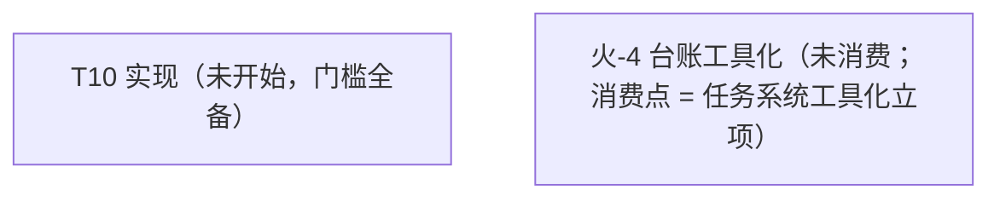

# Metis 台账（backlog）

> 状态：🔵 活跃（living；2026-10-14 立 = [ADR-0032](decisions/0032-operating-protocol.md)）。本文件 = 任务队列 + 遗留登记 + 火花区 + 全景图四位一体的**运行状态 SSOT**（git 追踪）。**临时方案**——长期需要一个工具承担任务状态管理，而非并发 agent 直接读写本文件（火-4；扩展位登记 = [operating-protocol](design/operating-protocol.md) §6）。

## 读写纪律

- agent 全权维护：任务块状态、进展、收官压行由 agent 在会话收尾更新，随当次 commit 入库，无需逐项请示。
- 维护者聊天驱动：任务开立、拍板、方向变更由维护者对话触发；agent 不自立任务。
- 任务粒度闸：任务在设计 / 开立时即过 [operating-protocol](design/operating-protocol.md) §2 任务粒度（切分三属性 + 验收单元容量预算），非待拆分才过；超阈值的处置 = 拆分，方案以议题批出示、合并拍板。
- 任务块状态行 = 状态词（AGENTS.md Reporting 十词）+ 已完成范围 + 下一步 + 未拍板项 + 评审面三数（拍板决策点数 / self-review findings 数 / 评审耗时量级——诊断位，不设门禁）。
- 任务生命周期状态 = 未开始 / 进行中 / 阻塞 / 已完成 + **延后（deferred）**：无限期延后，重开 = 维护者明示——延后是队列处置态，不进 Reporting 十词。
- 收官压单行与离库：任务收官后块压成单行（状态词 + 日期 + 产出指针 ADR+SHA），过程叙事溯源 = ADR 正文 + git 史；收官行 = 衔接过渡态，默认存活约一个任务周期——旧行清理走压缩仪式微缩版（下次收官或巡检时出示 → 维护者批准；[doc-lifecycle](design/doc-lifecycle.md) §7），deferred 行例外（队列处置态，留至重开或维护者明示丢弃）。
- 并发窗口一任务一写者：同一时刻一个任务块只有一个写者；并行窗口内每 agent 只写自己的任务块（[operating-protocol](design/operating-protocol.md) §3）——写冲突结构性规避，不靠锁。
- 文档结构性改动视同共享契约串行：本文件的节结构与任务块格式改动不走并行窗口。
- git 追踪原则（维护者原话）：「我们不能依赖任何非 git 追踪的文件。不然会非常容易出现悬垂指针，导致文档腐烂。」——运行状态一律 git 追踪；外部服务只作对外接口（GitHub Issues 不迁队列、不建 label；外部事项被采纳时才以链接条目进本台账，单写者、无双向同步）。

## 全景图（活跃任务 + 未消费火花；任务或火花变更时重生成）

图 = 派生视图（内容 SSOT = 任务块与火花登记区）：只画活跃面（未开始 / 进行中 / 阻塞）+ 未消费火花节点（label = 火-N + 短语 + 消费点）；已完成 / 延后节点离图，已满足依赖不画边（满足态住任务块「依赖」行）。

## 内部任务

活跃任务一任务一块（状态词 / 依赖 / 进展状态行含评审面三数 / 产出指针）；收官或延后任务压单行（见末节记录）。

### T10 实现

- 状态：**未开始**（阻塞解除 = T12 ✅ 2026-10-14 收官）
- 依赖：T11（✅ 2026-10-14 收官）、T12（✅ 2026-10-14 收官 = [ADR-0033](decisions/0033-doc-lifecycle.md)）
- 开工门槛：审计流程完备（✅ ADR-0031）+ 开发流程完备（✅ T11 收官 = ADR-0032 + operating-protocol）+ HANDOFF 迁移完毕（✅ 同 T11 收官 commit）+ T12 收官（✅ 2026-10-14）——**门槛全备，可开工**
- 实现序：metis-value → metis-fiber-core → 事件系统（含 journal 拦截点）→ 服务注册表/inject → loader+配置 → Luau 绑定 → 安装事务
- 各实现期清单 SSOT = ADR-0027 / ADR-0028 / ADR-0031 Consequences（另 ADR-0032 登记：worktree bootstrap 自动化）
- 评审面三数：（开工后逐站记录）

### 收官与延后记录（单行）

- T9 marketplace 格式设计 — **deferred**（2026-10-14 维护者裁定：无限期延后；重开条件 = 维护者明示）。

## 外部事项

（空）GitHub Issues = 对外接口本位：不建 label、不把队列迁 issue；外部事项被采纳时才以「链接条目」进本台账（单写者、无双向同步）——ADR-0032。

## 遗留问题登记

- **默认插件集**（开箱即用参考实现）——原则已定（ADR-0024 §4）；shell tool / schedule 插件候选在案；核心设计链已收官，可立项。
- **global 核心数据根可达性复审**（self-review 提出）：若收紧，改 luau-abi §A3.7 一行。
- **Value::Bytes 提正触发器**（A6.4）：首个跨插件二进制消费者 → 走 ADR 演进。
- **秘密引用限审批档收紧裁量**（D67 明记代价；维护者裁量未做）。
- **org 级「允许 Actions 开 PR」开关**：org Settings → Actions → General → Workflow permissions 勾开（repo 级随后同开），或 `gh auth refresh -h github.com -s admin:org` 后走 API；未开前 flake-update / toolchain-update 周更在开 PR 一步 403，其余 CI 不受影响。

各类**扩展位/复审触发器**均已在对应 ADR/设计文档内登记（SSOT 原位不动，不迁）。

## 火花登记区

机制 = AGENTS.md Style 节 spark-capture 规则：引文逐字登记不压缩；消费 = 内容升格固化进对应 docs/ 或代码，条目即从本区删除（去向处即 SSOT 不留痕，本台账 git 史保底）；未消费不静默消失；议题出示前回读本区。

- 火-4（2026-10-14；消费点 = 任务系统工具化立项，未消费）：「先做临时方案吧，后面我们应该需要一个工具去做这个事情，而不是让并发的agent去读写这个内容。」；上下文锚 = 任务 11 改稿拍板回复（本台账定调）
